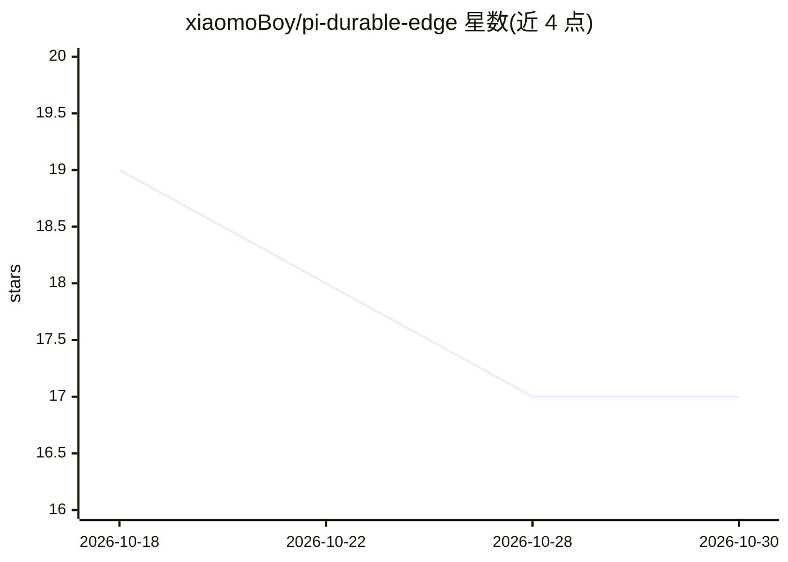

# xiaomoBoy/pi-durable-edge

⭐ 17 · JavaScript · MIT · 推送 2026-10-11 · [GitHub](https://github.com/xiaomoBoy/pi-durable-edge) · 个人维护 · 中文 README

**部署在 Cloudflare Workers 上的持久化个人聊天 Agent**

基于 Cloudflare Workers + SQLite-backed Durable Objects + PiHarness 的持久化个人 Agent，是 Pi Durable Assistant 的独立维护 Cloudflare 版本。支持 OpenAI Chat Completions/Responses、Anthropic Messages 与 Faux 模型配置，API Key 服务端加密保存；提供持久聊天记录、定时提醒与 REST API。通过 Deploy to Cloudflare 按钮一键部署，也可 npm 本地运行。当前为单用户、单 Durable Object，v0.2.1 已通过本地测试但远端部署与真实 API 仍待实测，多会话、附件等尚未实现。

## 筛选速览

| 维度 | 判定 | 备注 |
|---|---|---|
| AI 角色 | `ai-native` | 本体是模型或模型工具 |
| 许可风险 | `permissive` | MIT |
| 部署形态 | `library` | 以包/库形式分发 |
| 模型依赖 | — | README 未给出锁定关系 |
| 硬件要求 | — | 无带数字的原话,不猜 |
| 安装摩擦 | `low` | 无编译、无系统依赖或容器化 |
| 成熟度 | `idea` | |

## 能力要点

- 基于 Workers + Durable Objects 无服务器运行，一键部署
- 支持 OpenAI/Anthropic 模型配置，Faux 免费模式不调用收费模型
- 聊天记录与定时提醒持久化，刷新后可继续查看
- API Key 服务端加密，提供同源 CSP 等安全审查措施

## 适用场景

- 在 Cloudflare 免费额度上自托管个人 AI 助手
- 需要聊天记录和定时提醒持久保存的个人 Agent
- 通过 REST API 接入自己的模型配置

## 场景标签

`AI 助手` · 领域:对话与助手

## 证据(README 行号)

> L3: 基于 **Cloudflare Workers + SQLite-backed Durable Objects + PiHarness** 的持久化个人 Agent。独立维护的 Cloudflare 版本，源自 Pi Durable
> L14: - **模型配置**：OpenAI Chat Completions / Responses、Anthropic Messages 和 Faux；支持 HTTPS Base URL、API Key、模型 ID、上下文窗口、输出 T
> L15: - **持久聊天**：通过 PiHarness 提交消息并保存记录，可刷新后继续查看。

## 星数曲线

2026-10-18 19 → 2026-10-30 17（-2）

---
*卡片 v1 · prompt 1.4 · 生成 2026-10-29 · 置信度 high · 依据 README sha `9b609cd46791` · [字段定义](../../DATASET.md)*
