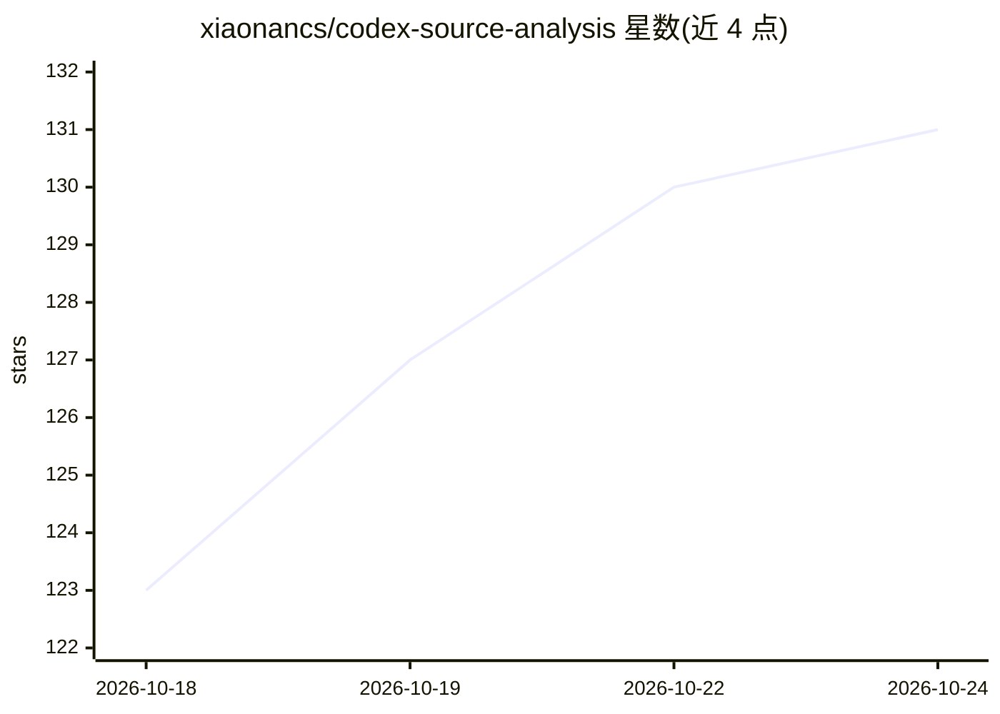

# xiaonancs/codex-source-analysis

⭐ 131 · JavaScript · NOASSERTION · 推送 2026-05-27 · [GitHub](https://github.com/xiaonancs/codex-source-analysis) · 个人维护 · 中文 README

**OpenAI Codex 源码深度研究文档集（30 篇 / 约 51 万字）**

对 OpenAI Codex CLI / Rust 主体（约 120 个 crate）/ TS+Python SDK 的系统性源码解析文档：2 篇总纲 + 25 章正文 + 3 个附录，约 51 万中文字、149 张 Mermaid 架构图。内容覆盖 Agent 核心循环、沙箱（Seatbelt/Bwrap/WFP）、MCP 双向集成、Plugin 市场、App-Server JSON-RPC 协议等，另含与 Claude Code / Opencode 的横向对比章节。面向想理解 Codex 内部实现的开发与研究人员；内容为 Markdown 文档仓库，需自行阅读，非可运行软件。

## 筛选速览

| 维度 | 判定 | 备注 |
|---|---|---|
| AI 角色 | `ai-knowledge` | 知识聚合/清单类 |
| 许可风险 | `none` | NOASSERTION |
| 部署形态 | `library` | 以包/库形式分发 |
| 模型依赖 | — | README 未给出锁定关系 |
| 硬件要求 | — | 无带数字的原话,不猜 |
| 安装摩擦 | `low` | 无编译、无系统依赖或容器化 |
| 成熟度 | — | 结构信号不足 |

## 能力要点

- 2 总纲 + 25 章 + 3 附录，约 51 万字 / 149 张 Mermaid 图
- 覆盖 Rust 主体 ~120 crate：Agent 循环、沙箱、MCP、App-Server 协议
- 含 Codex vs Claude Code / Opencode 架构对比章节
- 提供 npm run validate:mermaid 校验全部图表语法

## 适用场景

- 系统理解 OpenAI Codex 的 Rust 主体与多入口架构
- 研究 coding agent 的沙箱、权限模型与 MCP 集成实现
- 横向比较 Codex 与同类 coding agent 的架构设计

## 场景标签

 · 领域:AI Agent 源码研究/技术文档

## 证据(README 行号)

> L1: # OpenAI Codex 源码深度研究
> L3: > 这份研究覆盖 OpenAI Codex CLI / Rust 主体 / TS+Python SDK 全貌：**2 篇总纲 + 25 章正文 + 3 个附录**，约 **51 万中文字 / 1.5 MB Markdown** 与 

## 星数曲线

2026-10-18 123 → 2026-10-24 131（+8）

---
*卡片 v1 · prompt 1.4 · 生成 2026-10-22 · 置信度 mid · 依据 README sha `eb77baded338` · [字段定义](../../DATASET.md)*
