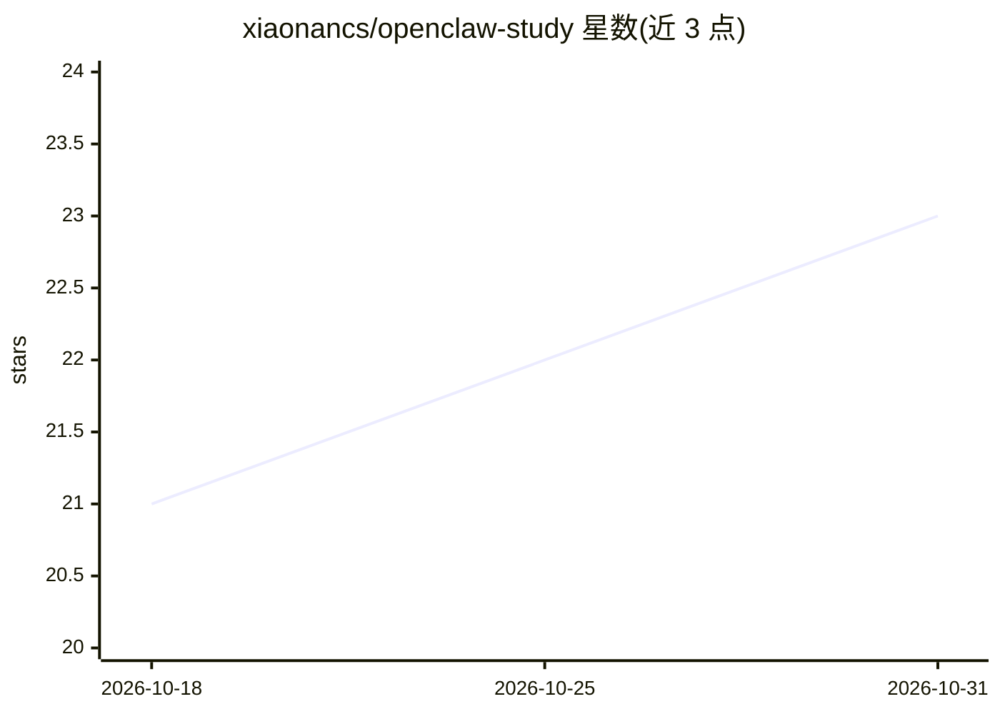

# xiaonancs/openclaw-study

⭐ 23 · JavaScript · NOASSERTION · 推送 2026-05-27 · [GitHub](https://github.com/xiaonancs/openclaw-study) · 个人维护 · 中文 README

**OpenClaw 源码深度研究：27 章技术分析与生态调研文档**

针对 openclaw/openclaw v2026.4.15 的系统性源码阅读与生态调研文档库：27 章覆盖架构设计、执行链路、通道与模型接入、fork/变种生态、PR 演进与缺陷分析，数据基线为 2026-04-17（约 23,014 条 commit、1,200 条 merged PR、数百个 fork）。附原始 PR/Issue 数据集与 fork 榜。属于系列研究的姊妹篇之一，文本采用 CC BY-SA 4.0，仅供阅读，无可安装组件。

## 筛选速览

| 维度 | 判定 | 备注 |
|---|---|---|
| AI 角色 | `ai-knowledge` | 知识聚合/清单类 |
| 许可风险 | `none` | NOASSERTION |
| 部署形态 | `None` |  |
| 模型依赖 | — | README 未给出锁定关系 |
| 硬件要求 | — | 无带数字的原话,不猜 |
| 安装摩擦 | `low` | 无编译、无系统依赖或容器化 |
| 成熟度 | — | 结构信号不足 |

## 能力要点

- 27 章覆盖架构、执行链路、通道/模型、生态演进与缺陷五大部分
- 基于 2026-02 以来约 23,014 条 commit、1,200 条 merged PR 的数据采集
- 附原始数据集与 Fork 活跃榜（Appendix/B-pr-issue-dataset）
- 遵循 source-deep-research 7 阶段工作流与七维写作框架

## 适用场景

- 系统性理解 OpenClaw 的架构与源码实现
- 了解 OpenClaw fork/变种生态与近期 PR 演进
- 查找缺陷聚类与优化方向的社区调研结论

## 场景标签

 · 领域:AI Agent/知识文档

## 证据(README 行号)

> L5: > 对 openclaw/openclaw @ v2026.4.15 的系统性源码阅读与生态调研。
> L34: - 总纲 — OpenClaw 技术主线分析

## 星数曲线

2026-10-18 21 → 2026-10-31 23（+2）

---
*卡片 v1 · prompt 1.4 · 生成 2026-10-27 · 置信度 high · 依据 README sha `09d426823211` · [字段定义](../../DATASET.md)*
