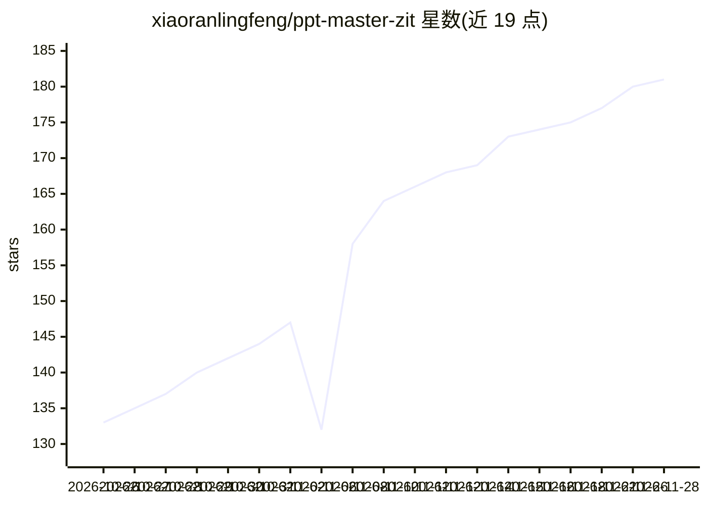

# xiaoranlingfeng/ppt-master-zit

⭐ 181 · Python · MIT · 推送 2026-11-27 · [GitHub](https://github.com/xiaoranlingfeng/ppt-master-zit) · 个人维护 · 中文 README

**本机 ComfyUI 配图的 PPT 生成技能分支，无需 API key**

ppt-master v6.10.0 的定制分支，保留上游全部可编辑 PPTX 生成工作流，唯一差异是 AI 配图默认走本机 ComfyUI 的 Qwen-Image-2.1 文生图工作流（7B DiT int8 + Qwen3-VL 8B int8，原生 RGBA），另可按 deck 切换 MOSS-Image SFT 与 Z-Image Turbo 工作流。以 agent skill 形式交付：放入 agent 技能目录或由可执行 Python 的 agent 调用。含 D0–D9 访谈门禁、导出后 PDF 逐页检查门禁、提示词签名 sidecar 实现局部重绘。限制：Qwen/MOSS 权重许可禁止商业使用；图像生成依赖本地 GPU，实测 RTX 3080 Laptop 约 15–25 秒/张（1K、25 步）。

## 筛选速览

| 维度 | 判定 | 备注 |
|---|---|---|
| AI 角色 | `ai-native` | 本体是模型或模型工具 |
| 许可风险 | `permissive` | MIT |
| 部署形态 | `desktop` | 安装包/桌面程序 |
| 模型依赖 | — | README 未给出锁定关系 |
| 硬件要求 | — | 无带数字的原话,不猜 |
| 安装摩擦 | `low` | 无编译、无系统依赖或容器化 |
| 成熟度 | — | 结构信号不足 |

## 能力要点

- 本机 ComfyUI 配图后端：无需 API key，提示词不出本机
- COMFY_MODEL=qwen|moss|zit 三套工作流按 deck 切换
- ComfyUI 未启动时自动拉起集成包并打开 Web UI
- 导出后经 soffice 转 PDF 并用 pymupdf 逐页核验的输出门禁

## 适用场景

- 在无网络/不出网环境下为本机生成 PPT 配图
- 用本地 GPU 批量生成可编辑 PPTX 而不产生按张计费
- 需要 RGBA 透明素材贴入任意底色幻灯片的排版场景

## 场景标签

`图像生成` · 领域:内容生成

## 证据(README 行号)

> L11: **PPT Master + local ComfyUI image backend.** This is a personal-machine fork of ppt-master (v6.10.0, MIT, Copyrigh
> L53: 2. Drop this folder into your agent's skills directory (e.g. `~/.hermes/skills/`, `~/.agents/skills/`), or use it w
> L104: **PPT Master + 本机 ComfyUI 配图后端** — 这是 ppt-master (v6.10.0, MIT, Copyright © 2025-2026 Hugo He) 的本机定制分支：整套可编辑 PPTX 

## 星数曲线

2026-10-26 133 → 2026-11-28 181（+48）

---
*卡片 v1 · prompt 1.4 · 生成 2026-11-26 · 置信度 high · 依据 README sha `782c44d70218` · [字段定义](../../DATASET.md)*
