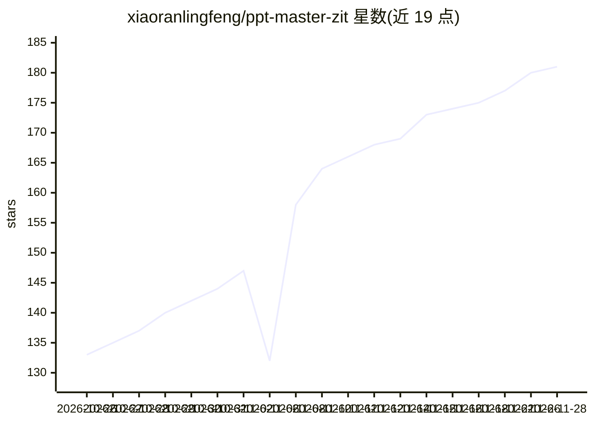

# xiaoranlingfeng/ppt-master-zit

⭐ 181 · Python · MIT · 推送 2026-11-27 · [GitHub](https://github.com/xiaoranlingfeng/ppt-master-zit) · 个人维护 · 中文 README

**ppt-master 的本机 ComfyUI 配图分支：本地生成可编辑 PPTX 插图**

ppt-master v6.10.0 的个人机分支，在保留上游可编辑 PPTX 全流程的基础上新增本机 ComfyUI 文生图后端并默认启用：默认 Qwen-Image-2.1 工作流，可按 deck 切换 MOSS-Image SFT 与 Z-Image Turbo，配图完全在本机运行、不需 API Key。以 agent 技能目录形式分发，放入技能目录或任何可执行 Python 的 agent 即可使用；运行需本机 ComfyUI 集成包与对应模型权重，Qwen/MOSS 权重许可证限制商用。

## 筛选速览

| 维度 | 判定 | 备注 |
|---|---|---|
| AI 角色 | `ai-native` | 本体是模型或模型工具 |
| 许可风险 | `permissive` | MIT |
| 部署形态 | `desktop` | 安装包/桌面程序 |
| 模型依赖 | — | README 未给出锁定关系 |
| 硬件要求 | — | 无带数字的原话,不猜 |
| 安装摩擦 | `low` | 无编译、无系统依赖或容器化 |
| 成熟度 | — | 结构信号不足 |

## 能力要点

- 本地 ComfyUI 后端默认 Qwen-Image-2.1，可切换 MOSS-Image SFT / Z-Image Turbo
- ComfyUI 未运行时自动启动集成包并打开 Web UI
- 导出后转 PDF 逐页校验的渲染产出门禁与 manifest 续跑机制
- 每个 deck 通过访谈门禁 D5 确认一次出图模型

## 适用场景

- 无 API Key、本机 GPU 环境下为演示文稿生成插图
- 需要提示词不出网、隐私敏感场景的 PPT 配图
- 编辑含原生 RGBA 透明插图的可编辑 PPTX

## 场景标签

`图像生成` · 领域:内容生成

## 证据(README 行号)

> L11: **PPT Master + local ComfyUI image backend.** This is a personal-machine fork of ppt-master (v6.10.0, MIT, Copyrigh
> L53: 2. Drop this folder into your agent's skills directory (e.g. `~/.hermes/skills/`, `~/.agents/skills/`), or use it w

## 星数曲线

2026-10-26 133 → 2026-11-28 181（+48）

---
*卡片 v1 · prompt 1.4 · 生成 2026-11-28 · 置信度 high · 依据 README sha `05b8c834efe6` · [字段定义](../../DATASET.md)*
