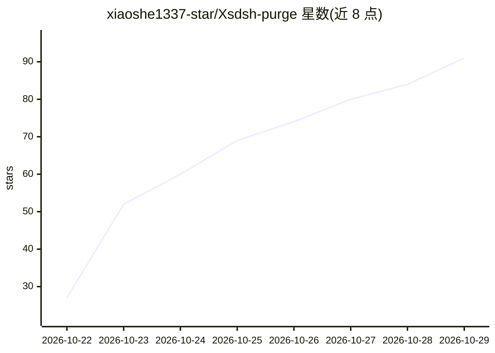

# xiaoshe1337-star/Xsdsh-purge

⭐ 91 · JavaScript · MIT · 推送 2026-10-18 · [GitHub](https://github.com/xiaoshe1337-star/Xsdsh-purge) · [官网](https://官方q群：1109345306) · 个人维护 · 中文 README

**DeepSeek Harness 官方客户端的红队安全评估插件**

面向已安装在用户本机的官方 DeepSeek Harness（dsh web 与官方桌面 EXE 0.2.1-rc.2）的网络安全红队插件（npm 包 dsh-purge，Node.js ≥18）。提供 dock 界面的 Clean 页（分组补丁状态、Apply/Restore/Uninstall、提示词编辑器与多规则集）与 Drill 页；将宿主层拦截与模型拒答两层分离以做受控评估，只修改本机 @deepseek-ai 包与本地配置，不针对第三方系统。声明非营利、MIT 许可，更新已暂停维护。

## 筛选速览

| 维度 | 判定 | 备注 |
|---|---|---|
| AI 角色 | `ai-ecosystem` | LLM/agent 周边工具 |
| 许可风险 | `permissive` | MIT |
| 部署形态 | `library` | 以包/库形式分发 |
| 模型依赖 | locked-api |  |
| 硬件要求 | — | 无带数字的原话,不猜 |
| 安装摩擦 | `low` | 无编译、无系统依赖或容器化 |
| 成熟度 | — | 结构信号不足 |

## 能力要点

- Clean 页提供补丁 Apply/Restore/Uninstall、提示词编辑器与多规则集
- 区分宿主层拦截与模型拒答，用于受控安全评估
- 仅作用于本机官方 @deepseek-ai 包与本地配置，启动时自动检查重应用

## 适用场景

- 在本机官方 DeepSeek Harness 上做红队鲁棒性评估
- 查看并调整 Harness 默认策略与提示词
- 在书面授权的演练环境中做本地渗透练习

## 场景标签

`网络安全` `模型评测` · 领域:评测与运维

## 证据(README 行号)

> L3:  ⚔️ DeepSeek Harness cybersecurity red-team tool (dsh-purge)
> L45: **dsh-purge** is a cybersecurity red-team plugin for the official DeepSeek Harness already installed on your machin
> L47: Harness does more than forward a prompt. It rewrites prompts, approval gates, sandbox policy, and session migration

## 星数曲线

2026-10-22 27 → 2026-10-29 91（+64）

---
*卡片 v1 · prompt 1.4 · 生成 2026-10-24 · 置信度 high · 依据 README sha `88774f7f463d` · [字段定义](../../DATASET.md)*
