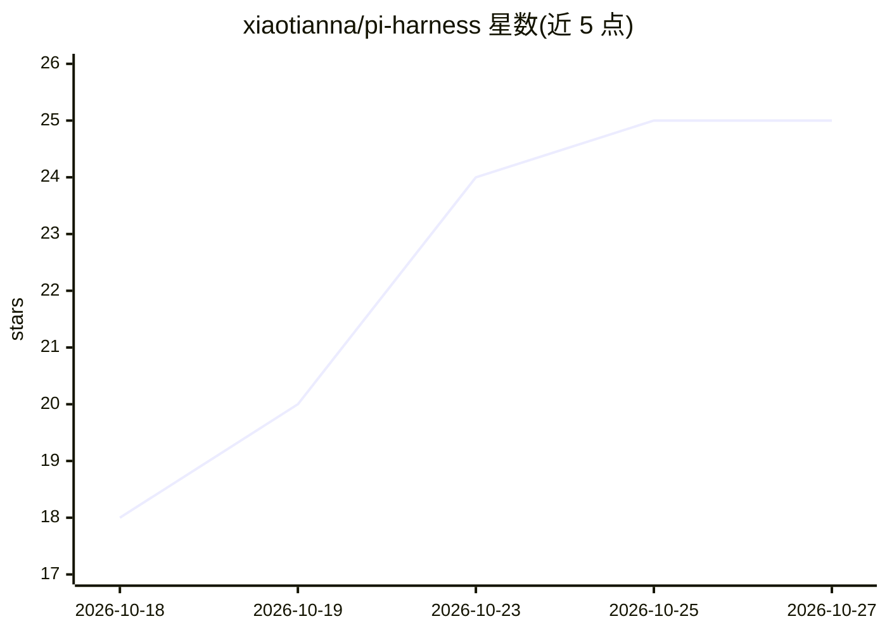

# xiaotianna/pi-harness

⭐ 25 · TypeScript · 推送 2026-10-08 · [GitHub](https://github.com/xiaotianna/pi-harness) · 个人维护 · 中文 README

**本地优先的 AI Agent 工作台，读写本地项目并并行派发 Sub Agent**

基于 @earendil-works/pi-agent-core 构建的桌面/浏览器 AI Agent 工作台：选定本地工作区后，Agent 可读写文件、修改代码、执行受审批监管的 Shell 命令、调用 MCP 工具与 Skills，主 Agent 可把任务拆给多个 Sub Agent 并行处理，任务中心展示状态与结果。架构为 Web（React 19）+ 本地 daemon（Node.js 24/Fastify）+ 可选 Tauri 桌面端，凭据与会话存于本机，模型请求仍发送到用户配置的 Provider。可选 Computer Use 仅支持 macOS 14+，可读取窗口截图与辅助功能树并定向发送点击/输入。

## 筛选速览

| 维度 | 判定 | 备注 |
|---|---|---|
| AI 角色 | `ai-native` | 本体是模型或模型工具 |
| 许可风险 | `none` | — |
| 部署形态 | `library` | 以包/库形式分发 |
| 模型依赖 | — | README 未给出锁定关系 |
| 硬件要求 | — | 无带数字的原话,不猜 |
| 安装摩擦 | `low` | 无编译、无系统依赖或容器化 |
| 成熟度 | — | 结构信号不足 |

## 能力要点

- 主 Agent 向多个 Sub Agent 并行委派任务，任务中心展示状态与结果
- 本地 daemon 管理文件/Shell/凭据，默认只监听 127.0.0.1，操作经路径检查、沙箱或审批
- 支持内置/自定义 Provider、Skills、插件市场与 MCP Server，MCP 工具按需查找
- 可选 Computer Use（仅 macOS 14+）：读取窗口截图与辅助功能树，定向发送输入

## 适用场景

- 把本地代码项目交给 Agent 读文件、改代码、跑命令并全程查看轨迹
- 将复杂任务拆分给多个 Sub Agent 并行处理
- 通过审批策略下让 Agent 操作指定 Mac 应用完成界面任务

## 场景标签

`编码 Agent` `多智能体` `GUI 自动化` · 领域:Agent 开发

## 证据(README 行号)

> L3: 一个运行在自己电脑上的 AI Agent 工作台。你可以把本地项目交给它，让它读文件、改代码、执行命令、调用外部工具，或者把任务拆给多个 Sub Agent 并行处理；整个过程都能在浏览器或桌面应用里看到。
> L13: - **直接处理本地项目**：选择一个工作区后，Agent 可以读取和搜索文件、修改代码、查看图片和文档，也可以执行受监管的 Shell 命令。
> L68: |Agent|`@earendil-works/pi-agent-core`、`@earendil-works/pi-ai`|Agent Loop、模型与 Provider 接入|

## 星数曲线

2026-10-18 18 → 2026-10-27 25（+7）

---
*卡片 v1 · prompt 1.4 · 生成 2026-10-26 · 置信度 high · 依据 README sha `9c998b4a92b2` · [字段定义](../../DATASET.md)*
