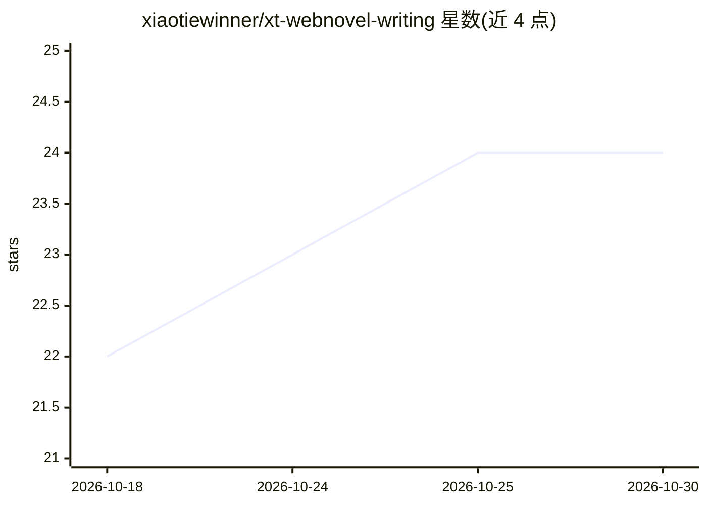

# xiaotiewinner/xt-webnovel-writing

⭐ 24 · TypeScript · 推送 2026-04-30 · [GitHub](https://github.com/xiaotiewinner/xt-webnovel-writing) · 个人维护 · 中文 README

**中文网文写作 agent skill：从拆解参考到长篇连载的流水线**

面向 OpenClaw / Hermes agent 的写作技能包：整个仓库即一个 skill，根 SKILL.md 为唯一入口，按意图关键词路由到 6 个 workflow.md 模块，串联参考文本拆解、立书、剧情设计、爽点与文笔、反 AI 味体检与项目持久化记忆。内置 18 主条款 + 7 子条款共 25 项「反 AI 味」检测，含回滚级硬门；支持 explore/publish 双模式与磁盘持久化 memory 契约（LOAD → 写稿 → VERIFY → PERSIST）。通过 openclaw skills install 安装，兼容 AgentSkills 类客户端。

## 筛选速览

| 维度 | 判定 | 备注 |
|---|---|---|
| AI 角色 | `ai-ecosystem` | LLM/agent 周边工具 |
| 许可风险 | `none` | — |
| 部署形态 | `None` |  |
| 模型依赖 | — | README 未给出锁定关系 |
| 硬件要求 | — | 无带数字的原话,不猜 |
| 安装摩擦 | `low` | 无编译、无系统依赖或容器化 |
| 成熟度 | — | 结构信号不足 |

## 能力要点

- 6 个 workflow.md 模块组成完整网文生成流水线
- 25 项「反 AI 味」检测条款与回滚级硬门
- explore / publish 双模式区分草稿与定稿验收
- 磁盘持久化 memory：章节命名契约与约每 10 章的周期性审计

## 适用场景

- 让 agent 按流水线开新书并逐章连载，保持设定与伏笔一致
- 对已有章节做 AI 味体检与改写
- 拆解参考文本并模仿其风格写作

## 场景标签

`AI 写作` · 领域:内容生成

## 证据(README 行号)

> L3: 中文网络小说写作 agent —— 一个 OpenClaw / Hermes skill。
> L5: 整个仓库就是一个 skill：**根目录 `SKILL.md` 是唯一入口**；内部由 6 个 `workflow.md` 模块串联完整流水线：参考文本拆解 → 立书 → 剧情设计 → 爽点与文笔 → 反 AI 味体检 → 项目持久
> L45: **说明**：OpenClaw 规范下「一个 skill = 一个目录 + 一个根 `SKILL.md`」。本仓库作为 ClawHub slug 发布时，**仅有根 `SKILL.md`** 会被识别为 skill；各 `webn

## 星数曲线

2026-10-18 22 → 2026-10-30 24（+2）

---
*卡片 v1 · prompt 1.4 · 生成 2026-10-27 · 置信度 high · 依据 README sha `39052c8bbe75` · [字段定义](../../DATASET.md)*
