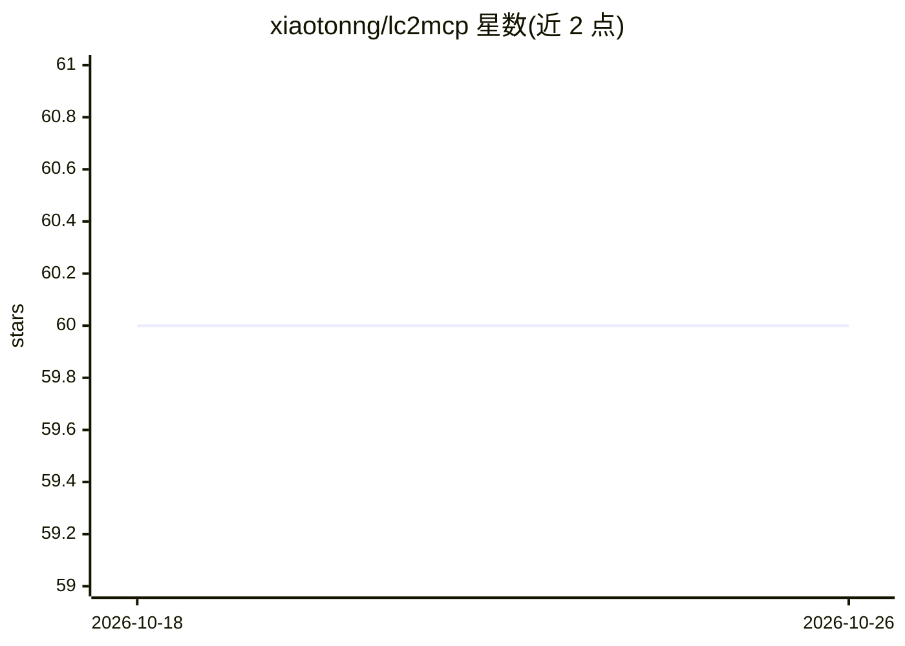

# xiaotonng/lc2mcp

⭐ 60 · Python · MIT · 推送 2026-01-31 · [GitHub](https://github.com/xiaotonng/lc2mcp) · 个人维护

**把 LangChain 工具转换为 FastMCP 工具的一行代码适配器**

面向使用 MCP 协议开发者的轻量 Python 适配库：通过 register_tools() 或 to_mcp_tool() 将已有的 LangChain 工具（@tool、StructuredTool、BaseTool 子类）转换为 FastMCP 工具并注册到 MCP 服务器，供 Claude、Cursor 等 MCP 客户端调用。自动完成 Pydantic 到 JSON Schema 的转换，支持上下文注入、MCP 进度通知与日志、命名空间前缀与名称冲突处理。要求 Python 3.10+、LangChain >= 1.0.0、FastMCP >= 2.0.0；与官方 langchain-mcp-adapters 方向相反，可配合使用。

## 筛选速览

| 维度 | 判定 | 备注 |
|---|---|---|
| AI 角色 | `ai-ecosystem` | LLM/agent 周边工具 |
| 许可风险 | `permissive` | MIT |
| 部署形态 | `library` | 以包/库形式分发 |
| 模型依赖 | — | README 未给出锁定关系 |
| 硬件要求 | — | 无带数字的原话,不猜 |
| 安装摩擦 | `low` | 无编译、无系统依赖或容器化 |
| 成熟度 | — | 结构信号不足 |

## 能力要点

- 一次函数调用将 LangChain 工具转换为 FastMCP 工具
- 自动 Pydantic → JSON Schema 转换，零样板代码
- 支持上下文注入、MCP 进度通知与日志、命名空间与冲突处理
- 接入 1000+ LangChain 社区工具（搜索/Wikipedia/SQL 等）

## 适用场景

- 把已有的 LangChain 工具暴露为 MCP 服务器供 Claude/Cursor 调用
- 利用 LangChain 社区工具生态快速搭建 MCP 工具服务
- 为工具注入认证上下文或实时上报执行进度

## 场景标签

 · 领域:LLM 基础设施/MCP 工具

## 证据(README 行号)

> L11: `lc2mcp` is a lightweight adapter that converts existing **LangChain tools** into **FastMCP tools**, enabling you t
> L7: **Convert LangChain tools to FastMCP tools — in one line of code.**

## 星数曲线

2026-10-18 60 → 2026-10-26 60（+0）

---
*卡片 v1 · prompt 1.4 · 生成 2026-10-24 · 置信度 high · 依据 README sha `f432c818a724` · [字段定义](../../DATASET.md)*
