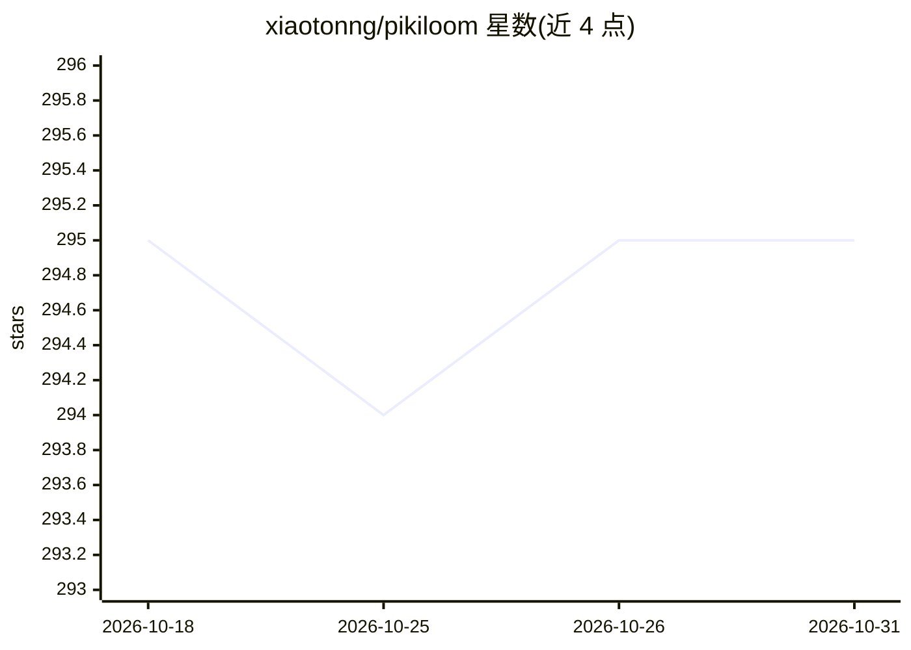

# xiaotonng/pikiloom

⭐ 295 · TypeScript · MIT · 推送 2026-10-26 · [GitHub](https://github.com/xiaotonng/pikiloom) · [官网](https://xiaotonng.github.io/pikiloom/) · 个人维护 · 中文 README

**开源多 Agent 编排器：从 IM/Web/CLI 并行驱动多个 AI Agent**

面向创作者与开发者的 Agent 编排运行时：内置 Claude Code、Codex、Gemini、Hermes 等 Agent 驱动，通过统一 AgentDriver 契约接入 CLI/ACP Agent；模型路由支持 Claude/GPT/Gemini、DeepSeek/豆包/Qwen 等国产模型、OpenRouter 及本地 Ollama/mlx-lm。入口层覆盖 Telegram、飞书、微信、Slack、Discord 等七个 IM 通道与 Web Dashboard/CLI，可在多面板并行运行 N 个 Agent 会话并中途切换 Agent。工具层合并 Skills、MCP 服务器与 CLI 工具注入会话。要求 Node 20+ 且至少安装一个官方 Agent CLI；提供 npx 启动与 Docker 镜像。

## 筛选速览

| 维度 | 判定 | 备注 |
|---|---|---|
| AI 角色 | `ai-ecosystem` | LLM/agent 周边工具 |
| 许可风险 | `permissive` | MIT |
| 部署形态 | `self-host` | docker 或自建部署 |
| 模型依赖 | local-ok | 支持本地模型 |
| 硬件要求 | — | 无带数字的原话,不猜 |
| 安装摩擦 | `low` | 无编译、无系统依赖或容器化 |
| 成熟度 | — | 结构信号不足 |

## 能力要点

- 内置 Claude Code/Codex/Gemini/Hermes 四种 Agent 驱动，支持 ACP 协议接入
- N 个 Agent 会话并行运行，可中途切换 Agent 且上下文延续
- 模型路由支持国产模型、OpenRouter 与本地 Ollama/mlx-lm
- 七个原生 IM 通道与 Web Dashboard、CLI 均为一等入口

## 适用场景

- 从手机 Telegram 上监控并接管本地运行的编码任务
- 在多面板中同时让不同 Agent 分别写码、测试与审查
- 将一个团队群变成共享的 Agent 编排工作台

## 场景标签

`多智能体` `编码 Agent` · 领域:Agent 开发

## 证据(README 行号)

> L7: *Plug in any agent (Claude · Codex · Gemini · Hermes · …), any model (Claude · GPT · Gemini · DeepSeek · Doubao · Mi
> L42: - **Pluggable Agents** — Claude Code, Codex, Gemini, and Hermes ship as built-in drivers. Hermes speaks ACP (Agent 
> L43: - **Model Routing** — Frontier (Claude · GPT · Gemini), Chinese domestic (DeepSeek · Doubao · MiMo · MiniMax · Qwen

## 星数曲线

2026-10-18 295 → 2026-10-31 295（+0）

---
*卡片 v1 · prompt 1.4 · 生成 2026-10-21 · 置信度 high · 依据 README sha `e151e235de83` · [字段定义](../../DATASET.md)*
