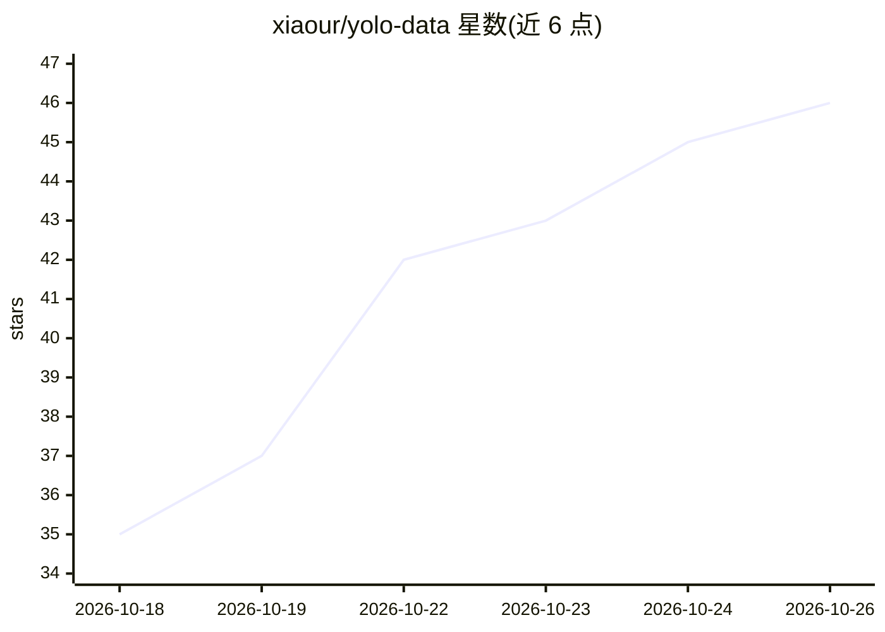

# xiaour/yolo-data

⭐ 46 · JavaScript · Apache-2.0 · 推送 2026-10-23 · [GitHub](https://github.com/xiaour/yolo-data) · [官网](https://xiaour.github.io/yolo-data/) · 组织维护 · 中文 README

**面向业务团队的自然语言问数与治理分析平台**

自助式企业数据分析平台：业务人员用自然语言提问、追问和对比，平台将问题解析为受控查询条件，基于管理员配置的指标口径、字段语义与权限编译只读查询，模型不直接提交原始 SQL。支持 MySQL/TiDB/Doris/PostgreSQL 数据源、按主题配置的智能体、行级权限与列脱敏、会话与工作区留存、Skills 扩展及 MCP 接入。管理员接入数据并配置授权范围；提供启动脚本与 Docker Compose 两种部署方式，需 Node.js 22.5+/Python 3 或 Docker 环境。

## 筛选速览

| 维度 | 判定 | 备注 |
|---|---|---|
| AI 角色 | `ai-native` | 本体是模型或模型工具 |
| 许可风险 | `permissive` | Apache-2.0 |
| 部署形态 | `self-host` | docker 或自建部署 |
| 模型依赖 | — | README 未给出锁定关系 |
| 硬件要求 | — | 无带数字的原话,不猜 |
| 安装摩擦 | `low` | 无编译、无系统依赖或容器化 |
| 成熟度 | — | 结构信号不足 |

## 能力要点

- 自然语言问数：平台解析为受控查询并校验范围与权限，模型不直接提交 SQL
- 行级权限、列隐藏/脱敏在服务端执行，支持查询与模型调用审计
- 连接 MySQL、TiDB、Doris、PostgreSQL 及指标目录，统一业务口径
- 通过 Streamable HTTP /mcp 提供 MCP 工具（指标发现、查询解析与执行）

## 适用场景

- 业务团队不写 SQL，直接用自然语言做趋势、对比和排行分析
- 企业按主题与数据范围管控分析权限并留存审计记录
- 把问数能力通过 MCP 接入其他智能体流程

## 场景标签

`数据分析` · 领域:效率与自动化

## 证据(README 行号)

> L5: 面向业务团队的自助数据分析平台：用自然语言提问，从统一口径的数据中获得可追溯的结果，并在同一会话里继续拆解、对比和分析。
> L29: - **指标与业务数据集**：对接指标目录，或连接 MySQL、TiDB、Doris、PostgreSQL。字段语义经过配置后用于生成只读查询；模型不会直接提交原始 SQL。支持字段同步、抽样、默认值域和查询审计。
> L36: - **MCP 接入**：通过 Streamable HTTP `/mcp` 提供指标发现、权限读取、快照读取、查询解析和执行工具；查询遵循“先解析、再执行”。详见 MCP 连接器。

## 星数曲线

2026-10-18 35 → 2026-10-26 46（+11）

---
*卡片 v1 · prompt 1.4 · 生成 2026-10-25 · 置信度 high · 依据 README sha `723e31adee8f` · [字段定义](../../DATASET.md)*
