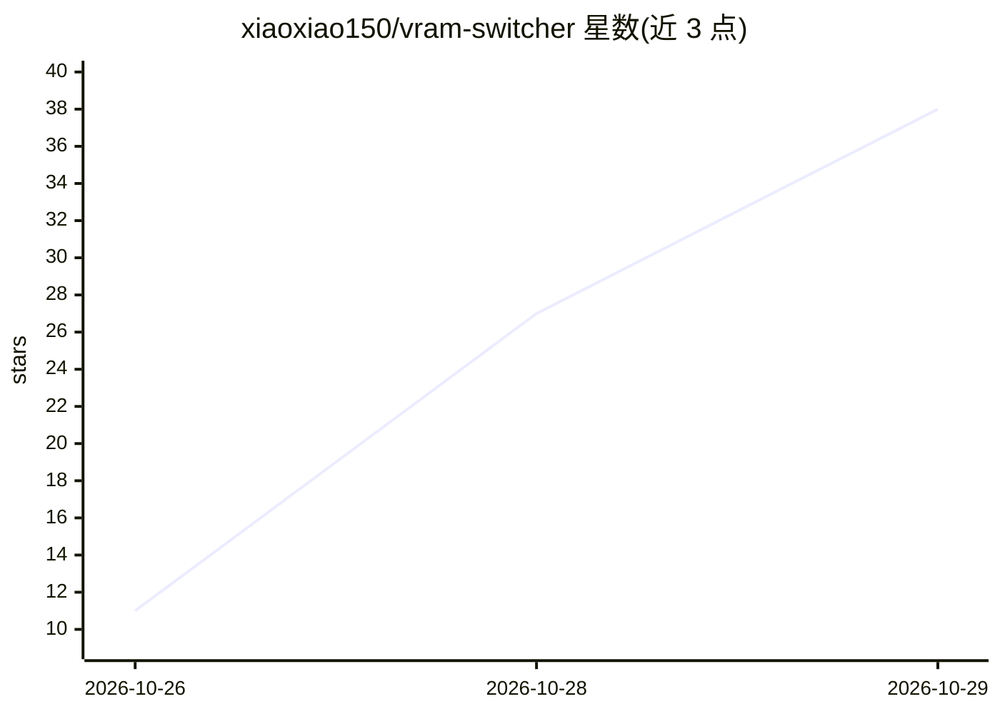

# xiaoxiao150/vram-switcher

⭐ 38 · Python · MIT · 推送 2026-10-27 · [GitHub](https://github.com/xiaoxiao150/vram-switcher) · [官网](https://github.com/xiaoxiao150/vram-switcher#readme) · 个人维护 · 中文 README

**给 AstrBot/DSH 本地 AI 陪伴的 GPU 调度插件：12 GB 卡上轮流跑 LLM/TTS/出图**

面向单张 12 GB 显存卡上运行的本地 AI 陪伴场景：通过进程停/起的状态机，让人设对话（本地 LLM）、IndexTTS 语音与 ComfyUI 生图在同一张卡上轮流独占显存，避免显存换页导致的性能下降。以 AstrBot 插件、DSH 原生 Cordis 插件与 MCP stdio 服务三种宿主形式提供，核心包 vram_switcher 可独立使用。不读 nvidia-smi、不换客户端、不加代理，只在事件边界停/起 profile 中列出的进程，并用 tts_busy.flag/tts_ready.flag 文件协议确定合成边界。限制：Windows 优先、NVIDIA 为生产验证路径、TTS 插件需自行实现文件协议。

## 筛选速览

| 维度 | 判定 | 备注 |
|---|---|---|
| AI 角色 | `ai-ecosystem` | LLM/agent 周边工具 |
| 许可风险 | `permissive` | MIT |
| 部署形态 | `desktop` | 安装包/桌面程序 |
| 模型依赖 | — | README 未给出锁定关系 |
| 硬件要求 | `cpu-ok` | |
| 安装摩擦 | `medium` | 含编译或系统依赖之一 |
| 成熟度 | `idea` | |

## 能力要点

- 进程级互斥：任务前停服务、任务后恢复，跨进程 coordinator.lock 串行
- IndexTTS busy/ready 文件协议确定真实合成边界（非 HTTP 边界）
- configure.py 自动探测运行中的服务并生成 profile
- 一套核心同时支持 AstrBot 插件、DSH 原生插件与 MCP 入口

## 适用场景

- 在 12 GB 单卡上让 AI 陪伴同时具备对话、语音与自拍/改图能力
- 避免 LLM、TTS、ComfyUI 共存导致显存换页、推理与出图变慢
- 不依赖通用 GPU 租约系统、不改客户端端口的前提下做显存协调

## 场景标签

 · 领域:本地 AI 基础设施/GPU 调度

## 证据(README 行号)

> L5: **为本地 AI 情感陪伴（AstrBot / DeepSeek Harness）原生接入的 GPU 调度器 —— 让人设对话、IndexTTS 语音和自拍/改图在同一张 12 GB 卡上轮流用卡。**
> L20: 它只负责这些「停/起」的**顺序**。不是模型、不是路由、也不是要你重写的启动器：所有机器相关的参数都在一个 JSON profile 里。
> L45: - **一套核心，两个宿主**：AstrBot（Python 插件）与 DeepSeek Harness（原生 Cordis 插件 + 小 Python daemon）。另带 MCP stdio 服务，可给 Claude Desk

## 星数曲线

2026-10-26 11 → 2026-10-29 38（+27）

---
*卡片 v1 · prompt 1.4 · 生成 2026-10-28 · 置信度 high · 依据 README sha `b08063482b35` · [字段定义](../../DATASET.md)*
