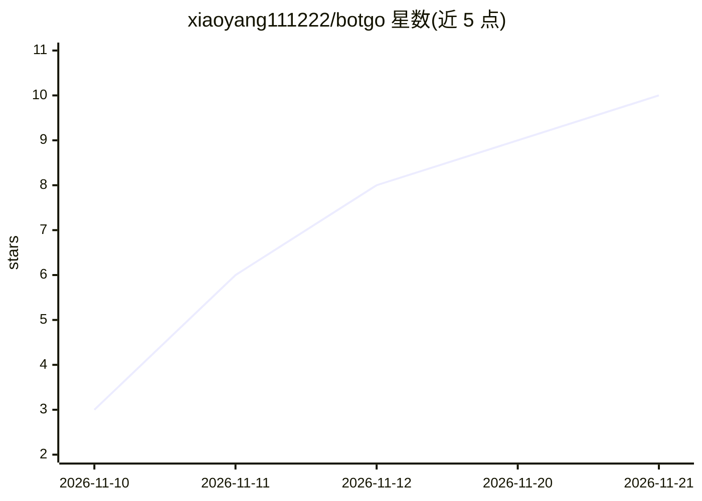

# xiaoyang111222/botgo

⭐ 10 · JavaScript · NOASSERTION · 推送 2026-11-10 · [GitHub](https://github.com/xiaoyang111222/botgo) · 个人维护 · 中文 README

**装在手机本地运行的个人 AI 助手 App，数据只存本机**

以 Capacitor 打包的安卓应用，助手本体为零依赖 Web 实现，无后端服务器与账号系统，与模型的通信由手机直连提供方接口。功能包括多提供方预设切换、任意 OpenAI 兼容接口接入、多 bot 人设与互相派活、仅存本机的长期记忆（可导出明文 JSON）、网页抓取与技能机制、语音输入与会话搜索。安装通过 Releases 页 APK；自建需 JDK 21 + Android SDK 执行构建脚本。许可证为 CC BY-NC 4.0，商业使用需单独授权。

## 筛选速览

| 维度 | 判定 | 备注 |
|---|---|---|
| AI 角色 | `ai-native` | 本体是模型或模型工具 |
| 许可风险 | `none` | NOASSERTION |
| 部署形态 | `library` | 以包/库形式分发 |
| 模型依赖 | locked-api |  |
| 硬件要求 | — | 无带数字的原话,不猜 |
| 安装摩擦 | `medium` | 含编译或系统依赖之一 |
| 成熟度 | — | 结构信号不足 |

## 能力要点

- 内置 DeepSeek、EXAONE、OpenAI、Claude、OpenRouter、硅基流动等提供方预设，支持任意 OpenAI 兼容接口
- 多 bot 人设与 delegate_task 互相派活（深度 1、240 秒超时）
- 长期记忆仅存手机本地，支持明文 JSON 导入导出
- 工具集含 web_fetch（带内网字面 IP 拦截）、memory_save、use_skill 等

## 适用场景

- 不通过厂商服务器，在手机上使用自己的 API key 聊天
- 建立多个不同专长的 bot 并让它们互相转派任务
- 把 AI 助手对话与记忆数据备份导出到文件

## 场景标签

`AI 助手` `聊天机器人` · 领域:对话与助手

## 证据(README 行号)

> L5: 不用注册、不用订阅、不用连任何人的服务器——下载装上，填入你自己的大模型 API key，它就是只为你一个人工作的 AI 助手。
> L26: - **多家模型随便换**：内置 DeepSeek、EXAONE、OpenAI、Claude、OpenRouter、硅基流动等提供方预设，也支持任意 OpenAI 兼容接口。谁便宜用谁，谁聪明用谁，随时切换。
> L47: - 助手本体是零依赖的 Web 技术实现（对话循环、工具调用、多 bot 协同、记忆系统全部在本地跑，代码在 www/js/），用 Capacitor 打包成安卓 App。

## 星数曲线

2026-11-10 3 → 2026-11-21 10（+7）

---
*卡片 v1 · prompt 1.4 · 生成 2026-11-20 · 置信度 high · 依据 README sha `56157338c599` · [字段定义](../../DATASET.md)*
