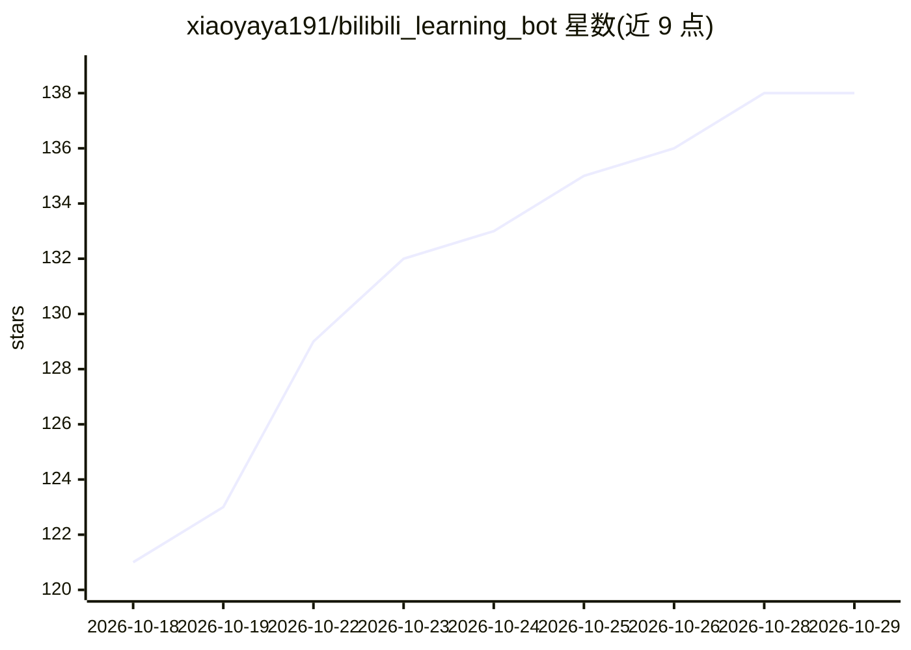

# xiaoyaya191/bilibili_learning_bot

⭐ 138 · Python · MIT · 推送 2026-10-10 · [GitHub](https://github.com/xiaoyaya191/bilibili_learning_bot) · [官网](https://bxya.app) · 个人维护 · 中文 README

**AI 驱动的 B 站自动刷视频与互动机器人，含 Web 管理面板**

面向个人用户的哔哩哔哩自动化机器人：AI 浏览推荐流并评分/点赞/收藏，自动归档高质量视频构建知识库（3 层分类 + 语义检索），自动回复评论与私信（持久上下文 + 长期记忆），支持 @bot 触发视频总结、ASR 语音转文字（FunASR/Whisper 可选）、视频生成 PPT 风格 HTML 与思维导图/Word 导出、人格管理与 AI 自我反思日志。通过统一 API Key 或任意 OpenAI 兼容端点接入模型。提供 Flask Web 面板、CLI、Windows EXE 一键打包、Docker 与 Android Termux 部署。项目声明非官方、仅限个人学习、不保证长期可用。

## 筛选速览

| 维度 | 判定 | 备注 |
|---|---|---|
| AI 角色 | `ai-native` | 本体是模型或模型工具 |
| 许可风险 | `permissive` | MIT |
| 部署形态 | `desktop` | 安装包/桌面程序 |
| 模型依赖 | — | README 未给出锁定关系 |
| 硬件要求 | — | 无带数字的原话,不猜 |
| 安装摩擦 | `low` | 无编译、无系统依赖或容器化 |
| 成熟度 | `idea` | |

## 能力要点

- AI 驱动推荐流浏览与评分互动，自动构建带语义检索的知识库
- 私信/评论自动回复，持久上下文与长期记忆
- 视频总结为 PPT 风格 HTML（19 种视觉风格）、思维导图与 Word 导出
- Web 面板 + CLI + Windows EXE + Docker + Termux 多种运行方式

## 适用场景

- 让 AI 替我在 B 站刷视频、筛选并归档高质量内容
- 自动回复粉丝私信与评论，维持账号互动
- 把长视频总结成网页讲解或思维导图用于学习复习

## 场景标签

`Agent 记忆` `语义搜索` `语音识别` · 领域:Agent 开发

## 证据(README 行号)

> L3: > **B站 AI 学习互动机器人** — AI 自动刷视频、学知识、评论互动、私信回复、自我进化，内置 Web 管理面板，支持一键打包 Windows EXE。
> L11: |📺 **智能视频浏览**|AI 驱动 B站推荐流浏览，自动判断内容价值（评分 / 收藏 / 投币 / 点赞）|

## 星数曲线

2026-10-18 121 → 2026-10-29 138（+17）

---
*卡片 v1 · prompt 1.4 · 生成 2026-10-22 · 置信度 high · 依据 README sha `b4c9ce5d0cfb` · [字段定义](../../DATASET.md)*
