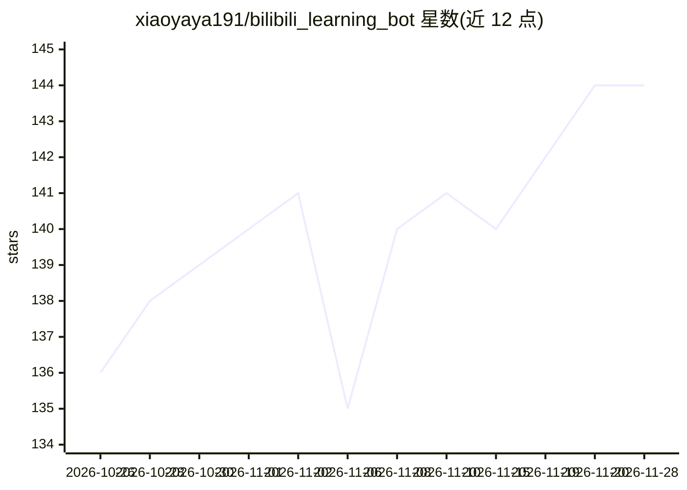

# xiaoyaya191/bilibili_learning_bot

⭐ 144 · Python · MIT · 推送 2026-11-21 · [GitHub](https://github.com/xiaoyaya191/bilibili_learning_bot) · [官网](https://bxya.app) · 个人维护 · 中文 README

**B站 AI 学习机器人：自动刷视频、评论私信、构建知识库**

运行于 B 站平台的 AI 自动化机器人，核心机制为：AI 驱动推荐流浏览并按兴趣评分决定三连行为，视频内容经 ASR/字幕转文字后归档进三层分类知识库并支持语义检索；私信与评论由带长期记忆的 AI 自动回复。提供 Flask Web 管理面板（35+ 分区）、CLI 菜单、Windows EXE 打包与 Docker/Termux 部署路径。README 免责声明强调非官方、仅限个人学习用途，且 B 站对同类逆向项目有法律行动先例。

## 筛选速览

| 维度 | 判定 | 备注 |
|---|---|---|
| AI 角色 | `ai-native` | 本体是模型或模型工具 |
| 许可风险 | `permissive` | MIT |
| 部署形态 | `desktop` | 安装包/桌面程序 |
| 模型依赖 | — | README 未给出锁定关系 |
| 硬件要求 | — | 无带数字的原话,不猜 |
| 安装摩擦 | `low` | 无编译、无系统依赖或容器化 |
| 成熟度 | — | 结构信号不足 |

## 能力要点

- Agent 技能系统：自主规划目标→搜索 B 站→看视频→总结知识的闭环
- 知识库三层分类+语义检索，自动提炼可复用技能卡片
- 视频一键转 19 种视觉风格的 PPT 式 HTML 讲解页
- 支持 Docker/docker-compose、Windows EXE 一键打包与 Termux 一键安装

## 适用场景

- 让 AI 代替自己刷 B 站学习内容并归档进知识库
- 自动回复粉丝私信与评论，带上下文和长期记忆
- 把视频总结成网页讲解页/思维导图/Word 文档

## 场景标签

`Agent 记忆` `语义搜索` `知识库管理` · 领域:Agent 开发

## 证据(README 行号)

> L3: > **B站 AI 学习互动机器人** — AI 自动刷视频、学知识、评论互动、私信回复、自我进化，内置 Web 管理面板，支持一键打包 Windows EXE。
> L11: |📺 **智能视频浏览**|AI 驱动 B站推荐流浏览，自动判断内容价值（评分 / 收藏 / 投币 / 点赞）|
> L20: |🤖 **Agent 技能系统**|自主规划目标 → 搜索 B站 → 看视频 → 总结知识，全自动闭环|

## 星数曲线

2026-10-26 136 → 2026-11-28 144（+8）

---
*卡片 v1 · prompt 1.4 · 生成 2026-11-28 · 置信度 high · 依据 README sha `376f970efd65` · [字段定义](../../DATASET.md)*
