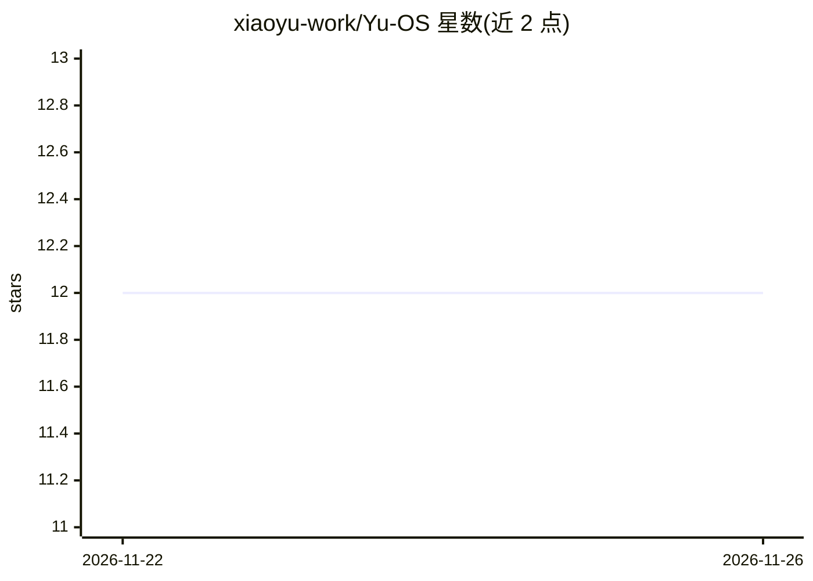

# xiaoyu-work/Yu-OS

⭐ 12 · Rust · Apache-2.0 · 推送 2026-11-25 · [GitHub](https://github.com/xiaoyu-work/Yu-OS) · 个人维护

**面向开发者的 agent 原生操作系统：AI 作为系统层运行**

Yu OS 是一个以 agent 为系统层组件的操作系统项目：AI 以特权系统服务运行，可读取进程、日志、网络与资源来回答诊断类问题；提供持久记忆、跨应用会话、能力检查与审批机制，并内置模型层供应用通过 yuos-sdk（Rust/Python/Node/Go）调用，本地模型优先、按硬件回退云端 API。当前处于积极开发中，架构与 API 可能大幅变动。安装方式覆盖 Ubuntu 上的 APT agent 层、WSL、Docker、QEMU/VMware 镜像及 Azure VHD 构建。

## 筛选速览

| 维度 | 判定 | 备注 |
|---|---|---|
| AI 角色 | `ai-native` | 本体是模型或模型工具 |
| 许可风险 | `permissive` | Apache-2.0 |
| 部署形态 | `self-host` | docker 或自建部署 |
| 模型依赖 | — | README 未给出锁定关系 |
| 硬件要求 | — | 无带数字的原话,不猜 |
| 安装摩擦 | `low` | 无编译、无系统依赖或容器化 |
| 成熟度 | `idea` | |

## 能力要点

- AI 以特权系统服务运行，可诊断网络、崩溃、磁盘占用等系统问题
- 提供 yuos-sdk（Rust/Python/Node/Go）供应用接入系统模型层
- 本地模型优先，硬件不足时回退云端 AI API
- 支持 APT、WSL、Docker、QEMU、VMware、Azure 多种安装/构建路径

## 适用场景

- 在 Ubuntu/WSL 上安装 agent 层并通过自然语言诊断系统问题
- 构建调用系统内置模型层的 AI 应用而无需自行集成模型
- 以 Docker 容器或虚拟机形式运行和测试该系统

## 场景标签

`AI 助手` `Agent 框架` `Agent 记忆` · 领域:Agent 开发

## 证据(README 行号)

> L20: - **The AI is part of the system, not an app on top of it.** It runs as a
> L39: - **Every app can use the system's models.** Apps call the built-in model layer
> L44: - **Local-first.** The system's intelligence belongs on your own machine, not

## 星数曲线

2026-11-22 12 → 2026-11-26 12（+0）

---
*卡片 v1 · prompt 1.4 · 生成 2026-11-22 · 置信度 mid · 依据 README sha `9b15802310cd` · [字段定义](../../DATASET.md)*
