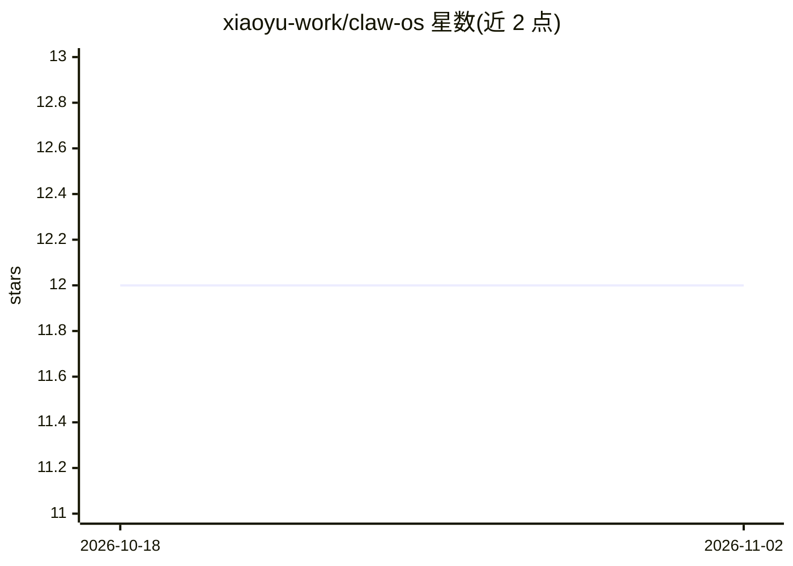

# xiaoyu-work/claw-os

⭐ 12 · Rust · Apache-2.0 · 推送 2026-10-29 · [GitHub](https://github.com/xiaoyu-work/claw-os) · 组织维护 · 中文 README

**将 AI agent 作为系统层的实验性 Linux 操作系统**

Claw OS 是一个处于活跃开发期、架构可能大幅变动的 agent-native 操作系统发行方案。AI 以特权系统服务形式内置于系统层而非独立应用：可读取进程、日志、网络与资源状态回答系统问题，跨应用执行操作并保有持久记忆。应用通过 claw-os-sdk（Rust/Python/Node/Go）向 agent 开放能力，可调用内置模型层（本地或云端）。模型运行采用 local-first 策略，本地不够时回退云端 API。提供 Ubuntu agent 层安装包、WSL 分发、Docker 镜像及实验性 VM/桌面镜像多种安装途径。

## 筛选速览

| 维度 | 判定 | 备注 |
|---|---|---|
| AI 角色 | `ai-native` | 本体是模型或模型工具 |
| 许可风险 | `permissive` | Apache-2.0 |
| 部署形态 | `self-host` | docker 或自建部署 |
| 模型依赖 | — | README 未给出锁定关系 |
| 硬件要求 | — | 无带数字的原话,不猜 |
| 安装摩擦 | `low` | 无编译、无系统依赖或容器化 |
| 成熟度 | `idea` | |

## 能力要点

- AI 作为特权系统服务运行，可读取进程/日志/网络/资源状态
- 单一 agent 跨应用操作并具备可审查的持久记忆
- 应用通过 claw-os-sdk（Rust/Python/Node/Go）向 agent 开放 API
- local-first 模型层：本地硬件可跑则本地，否则回退云端 API

## 适用场景

- 用自然语言询问并诊断系统问题（网络、崩溃、磁盘占用）
- 让一个 agent 跨多个应用组合完成工作流
- 在不替换 Ubuntu 的前提下安装 agent 层试用

## 场景标签

`AI 助手` · 领域:对话与助手

## 证据(README 行号)

> L16: Agent-native is the whole bet: the next operating system is one where the
> L20: - **The AI is part of the system, not an app on top of it.** It runs as a
> L39: - **Every app can use the system's models.** Apps call the built-in model layer

## 星数曲线

2026-10-18 12 → 2026-11-02 12（+0）

---
*卡片 v1 · prompt 1.4 · 生成 2026-11-01 · 置信度 mid · 依据 README sha `04038d6859b4` · [字段定义](../../DATASET.md)*
