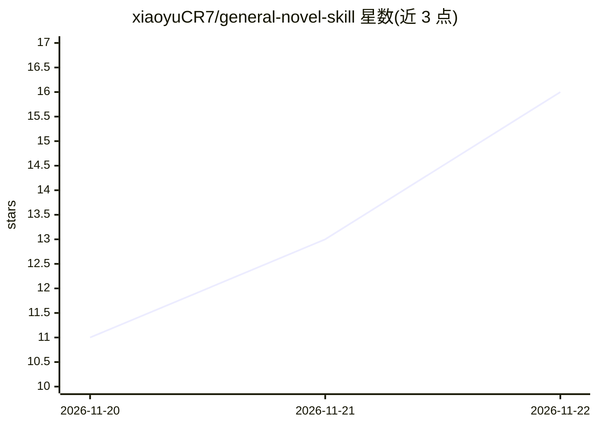

# xiaoyuCR7/general-novel-skill

⭐ 16 · Python · MIT · 推送 2026-11-19 · [GitHub](https://github.com/xiaoyuCR7/general-novel-skill) · 个人维护 · 中文 README

**给网文作者的 AI 写作 skill：长篇事务追踪与去 AI 味闸门**

以 agent skill 形式分发的中文网文创作工具：长篇模式下每章以事务方式提交正文与章节摘要、角色状态、伏笔台账等追踪文件，失败回滚，变更需附正文原文出处；短篇走五段式并以情绪与反转收尾。含 7 道去 AI 味闸口、34 类题材与多平台规则的可插拔参考文件、47 个 Python 脚本与 24 个 MCP 工具，并提供本地 Dashboard 与四角色编辑团队 agent 定义。支持 Claude Code、Codex、Cursor 等客户端；联网调研、RAG 与 MCP 为可选增强，缺省时回退本地主链。

## 筛选速览

| 维度 | 判定 | 备注 |
|---|---|---|
| AI 角色 | `ai-native` | 本体是模型或模型工具 |
| 许可风险 | `permissive` | MIT |
| 部署形态 | `library` | 以包/库形式分发 |
| 模型依赖 | — | README 未给出锁定关系 |
| 硬件要求 | — | 无带数字的原话,不猜 |
| 安装摩擦 | `low` | 无编译、无系统依赖或容器化 |
| 成熟度 | — | 结构信号不足 |

## 能力要点

- 每章事务化提交：正文与追踪表一起入库，失败自动回滚，变更附正文出处
- 7 道去 AI 味闸口定位套路句式，并防改过头的另一种腔调
- 34 题材与多平台（番茄/起点/晋江/盐言等）规则做成可插拔参考文件
- 本地 Dashboard 支持编辑与 revision 冲突保护，默认仅绑定 127.0.0.1

## 适用场景

- 在 Claude Code 里用自然语言开书、写章节、管理连载追踪
- 写知乎盐言、番茄短篇等平台的短篇故事
- 拆解对标作品、扫榜分析题材趋势
- 带旧稿接手已有连载并续写

## 场景标签

`AI 写作` · 领域:内容生成

## 证据(README 行号)

> L3: 写长篇网文与短篇小说的 agent skill（**v8.2.0**）：长篇正文和设定一起提交，追踪表里的每条事实都查得到正文出处；
> L4: 短篇走五段式、以情绪和反转收尾。去 AI 味不把好句子改坏。适用于 Claude Code、Codex、Cursor、OpenCode 等支持 skill 的客户端。
> L204: general-novel-skill 支持多个 AI 客户端：Claude Code、TRAE、Cursor、OpenCode、Codex、Gemini CLI、Antigravity，以及任何支持 MCP 协议的客户端。装好

## 星数曲线

2026-11-20 11 → 2026-11-22 16（+5）

---
*卡片 v1 · prompt 1.4 · 生成 2026-11-20 · 置信度 mid · 依据 README sha `8a72e93d6f44` · [字段定义](../../DATASET.md)*
