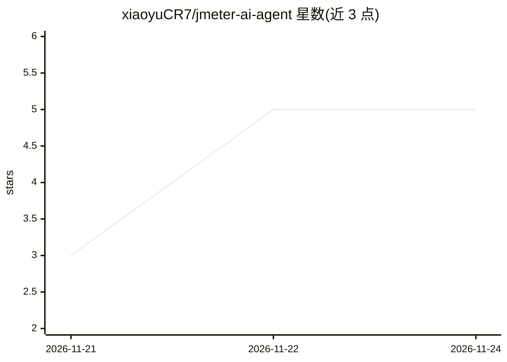

# xiaoyuCR7/jmeter-ai-agent

⭐ 5 · Python · Apache-2.0 · 推送 2026-11-12 · [GitHub](https://github.com/xiaoyuCR7/jmeter-ai-agent) · 个人维护 · 中文 README

**本地 AI agent：将性能测试文档转为可核验的 JMeter 压测判定**

面向 Apache JMeter 的本地 AI agent：从测试文档提取量化需求（P95、错误率、TPS 等），生成并运行测试计划，按逐条需求对每次运行输出判定，附基线对比与 Prometheus 服务端指标；AI 分析必须引用需求 ID 与实测值，无法佐证的内容标记为假设。内置 MCP 端点供 Claude Code、Cursor 等客户端调用。需 Python 3.11+、Node.js 20+、Java 11+ 与 JMeter 5.6.3，仅监听回环地址，无账号登录。

## 筛选速览

| 维度 | 判定 | 备注 |
|---|---|---|
| AI 角色 | `ai-native` | 本体是模型或模型工具 |
| 许可风险 | `permissive` | Apache-2.0 |
| 部署形态 | `library` | 以包/库形式分发 |
| 模型依赖 | local-ok | 支持本地模型 |
| 硬件要求 | — | 无带数字的原话,不猜 |
| 安装摩擦 | `medium` | 含编译或系统依赖之一 |
| 成熟度 | — | 结构信号不足 |

## 能力要点

- 文档→需求→测试计划→运行→判定的工作流，每条需求附来源引句
- 25 个模型预设，含本地 Ollama、LM Studio、vLLM 及 OpenAI/Anthropic 兼容 API
- 内置 MCP Streamable HTTP 端点，提供 get_execution_evidence 等证据工具
- 容量搜索逐步加压至需求失败点，并支持 ci_gate.py 作为 CI 门槛

## 适用场景

- 把接口性能测试文档转成带判定的压测报告
- 压测后对比基线判断性能是否回退
- 通过 Claude Code 或 Cursor 以 MCP 方式调用压测证据
- 在 CI 流水线中用 ci_gate.py 阻断不达标构建

## 场景标签

`工作流自动化` · 领域:效率与自动化

## 证据(README 行号)

> L5: A local AI agent for Apache JMeter: it reads your requirements, builds the test plan, runs it,
> L27: JMeter Agent produces those answers deterministically, then lets the AI explain them — and the AI must cite
> L41: 1. **Document → requirements.** Paste a spec or upload a file. AI drafts quantified requirements (P90/P95/P99, aver

## 星数曲线

2026-11-21 3 → 2026-11-24 5（+2）

---
*卡片 v1 · prompt 1.4 · 生成 2026-11-21 · 置信度 high · 依据 README sha `d71be95ad761` · [字段定义](../../DATASET.md)*
