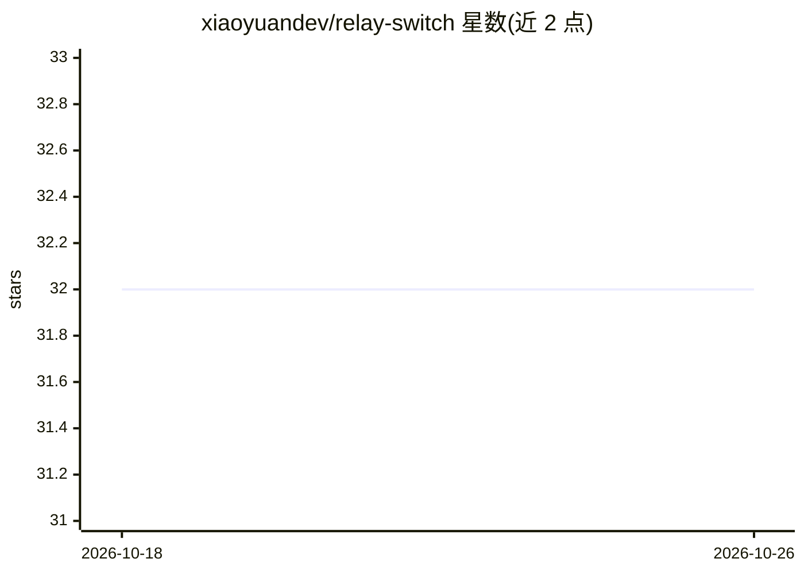

# xiaoyuandev/relay-switch

⭐ 32 · TypeScript · AGPL-3.0 · 推送 2026-07-02 · [GitHub](https://github.com/xiaoyuandev/relay-switch) · [官网](https://www.relayswitch.dev/) · 个人维护 · 中文 README

**本地 AI 网关：一键切换中转 API 与原生模型来源**

在本地运行一个统一入口（默认 http://127.0.0.1:3456/v1），供 Cursor、Kiro、Cherry Studio、Codex、Claude Code、VSCode 等工具一次性接入；之后在界面内切换中转 API 服务商或原生模型来源，无需修改各工具配置或重启。提供桌面版客户端（Windows/macOS/Linux）与 WSL/Linux Server 命令行安装（install.sh + systemd --user 服务），内嵌 Web 管理界面。Provider 页面管理远程中转站，Models 页面维护本地 Models Gateway 管理原生模型来源；限制：Anthropic 风格完整本地协议仍在完善，OpenAI-compatible 为主路径；请求日志仅存本地不上传。

## 筛选速览

| 维度 | 判定 | 备注 |
|---|---|---|
| AI 角色 | `ai-ecosystem` | LLM/agent 周边工具 |
| 许可风险 | `viral` | AGPL-3.0 |
| 部署形态 | `desktop` | 安装包/桌面程序 |
| 模型依赖 | — | README 未给出锁定关系 |
| 硬件要求 | — | 无带数字的原话,不猜 |
| 安装摩擦 | `low` | 无编译、无系统依赖或容器化 |
| 成熟度 | — | 结构信号不足 |

## 能力要点

- 本地统一入口 http://127.0.0.1:3456/v1，切换上游不改工具配置、不重启
- Providers 管理远程中转 API，Models 内嵌本地 Models Gateway 管理原生模型来源（OpenAI/Anthropic 兼容）
- 对 Codex CLI、Claude Code 提供一键接入及模型槽位映射（/model 切换）
- 网页 Deep Link 一键导入 Provider/Model 配置，API Key 可用模型探测

## 适用场景

- 多个中转 API 服务商之间快速切换，避免额度用尽或掉线中断使用
- 同时使用 Cursor、Claude Code、Codex 等多工具时只配置一次本地地址
- 在本地统一管理 MiniMax、DeepSeek 等原生模型来源并通过兼容网关暴露

## 场景标签

`模型网关` · 领域:Agent 开发

## 证据(README 行号)

> L7: Relay Switch 把多个 AI 中转 API、原生大模型来源和本地工具接入统一到一个本地入口。
> L21: Relay Switch 的做法是在你的工具前面放一个本地网关。
> L34: 2. 在本地维护一个 Local Gateway，用来管理希望直接接入各类兼容 OpenAI 或者 Anthropic 接口的原生大模型的使用场景。例如 MiniMax、DeepSeek 等。在模型页面添加，在供应商页面启用 Lo

## 星数曲线

2026-10-18 32 → 2026-10-26 32（+0）

---
*卡片 v1 · prompt 1.4 · 生成 2026-10-25 · 置信度 mid · 依据 README sha `8398710a7816` · [字段定义](../../DATASET.md)*
