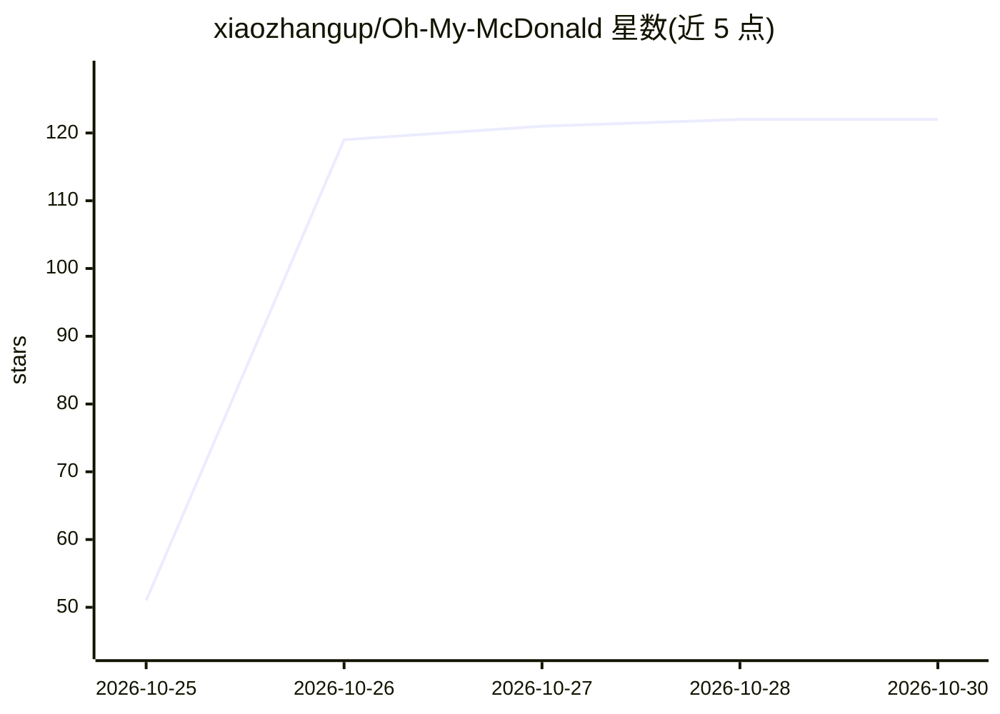

# xiaozhangup/Oh-My-McDonald

⭐ 122 · Python · MIT · 推送 2026-10-24 · [GitHub](https://github.com/xiaozhangup/Oh-My-McDonald) · 个人维护 · 中文 README

**基于麦当劳官方 MCP 的对话式点餐决策 AI Skill**

面向麦当劳消费者的对话式 AI Skill：AI 通过麦当劳官方 MCP 的 10 个工具查询餐品、门店价格、优惠券、活动与营养数据，按用户的预算、排除条件筛选推荐，确认后保存食用与探店记录。本地 Python 脚本负责数据处理与体素渲染，将查询结果生成为餐品图鉴、优惠日历、门店比价、营养餐桌四种 PNG 场景，不依赖图片生成 API。限制：不支持自动下单付款领券，价格比较最多 3 家门店，需自备 MCP Token 与中文字体。

## 筛选速览

| 维度 | 判定 | 备注 |
|---|---|---|
| AI 角色 | `ai-native` | 本体是模型或模型工具 |
| 许可风险 | `permissive` | MIT |
| 部署形态 | `library` | 以包/库形式分发 |
| 模型依赖 | — | README 未给出锁定关系 |
| 硬件要求 | — | 无带数字的原话,不猜 |
| 安装摩擦 | `low` | 无编译、无系统依赖或容器化 |
| 成熟度 | — | 结构信号不足 |

## 能力要点

- 通过麦当劳官方 MCP 的 10 个查询工具获取真实餐品/门店/优惠/营养数据
- 内置 43 个体素模型的本地 Python 渲染器，输出四种 PNG 可视化场景
- 食用与探店记录需用户确认后才保存并点亮图鉴
- 不依赖 OpenAI API 或其他图片生成 API

## 适用场景

- 按预算和口味排除条件让 AI 推荐今天吃什么
- 比较附近最多 3 家门店同款商品的价格
- 查看可用优惠券、近期活动并生成优惠日历图片
- 记录吃过的餐品并生成体素图鉴

## 场景标签

`数据分析` · 领域:效率与自动化

## 证据(README 行号)

> L7: **Oh-My-McDonald** 是一个基于麦当劳官方 MCP 的对话驱动 AI Skill。
> L45: 项目通过麦当劳官方 MCP 获取餐品、门店、价格、优惠和营养信息，由 AI 理解用户的自然语言需求，再交给 Python 脚本完成查询辅助、数据处理、记录保存和图片渲染。
> L326: 本项目不要求使用特定的 AI 模型，也不依赖 OpenAI API。

## 星数曲线

2026-10-25 51 → 2026-10-30 122（+71）

---
*卡片 v1 · prompt 1.4 · 生成 2026-10-24 · 置信度 mid · 依据 README sha `b966f763a7ae` · [字段定义](../../DATASET.md)*
