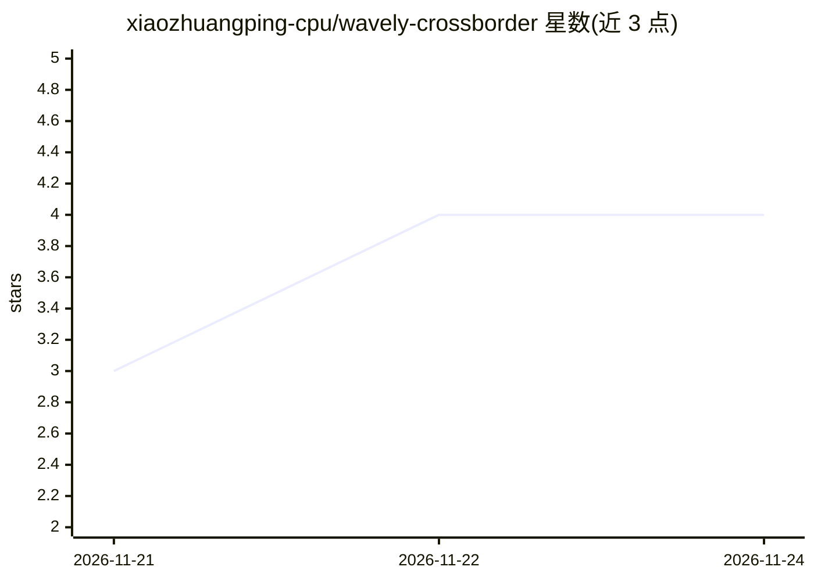

# xiaozhuangping-cpu/wavely-crossborder

⭐ 4 · JavaScript · MIT · 推送 2026-11-11 · [GitHub](https://github.com/xiaozhuangping-cpu/wavely-crossborder) · [官网](https://xiaozhuangping-cpu.github.io/wavely-crossborder/) · 个人维护 · 中文 README

**跨境电商全链路演示：ERP+独立站+仓库App+AI助手**

虚构品牌「Wavely 海浪优选」的跨境电商演示项目，覆盖 ERP 后台（订单、SKU、多仓库存、补货采购、审批流、RBAC）、五语言独立站、Flutter 仓库 App（扫码收发货）与 1688 采集 Chrome 插件。AI 部分包括：运营助手（问销售、找补货、写多语言 Listing，只读工具服务端执行、写操作生成提案待确认）、独立站 AI 客服、商品名翻译本地化与 AI 生成场景短片。后端跑在 Supabase 免费版，数据每日自动重置；前端为 React + Flutter，代码与演示数据由 Claude Code 辅助生成。

## 筛选速览

| 维度 | 判定 | 备注 |
|---|---|---|
| AI 角色 | `ai-enhanced` | 去掉 AI 部分产品仍成立 |
| 许可风险 | `permissive` | MIT |
| 部署形态 | `library` | 以包/库形式分发 |
| 模型依赖 | locked-api |  |
| 硬件要求 | — | 无带数字的原话,不猜 |
| 安装摩擦 | `medium` | 含编译或系统依赖之一 |
| 成熟度 | `idea` | |

## 能力要点

- AI 运营助手：问销售数据、找补货商品、写 Listing、批量发货，写操作生成提案待确认
- 访客可切换 DeepSeek、通义千问、Kimi 等模型并自带 API Key（浏览器存储、服务端转发）
- 1688 采集插件 + 商品名/规格 AI 翻译（中英德日西），一键导出 Shopify/Amazon/Shopee/TikTok Shop 上架模板
- 数据库层 RBAC（require_role）与不可篡改操作日志，采购审批流

## 适用场景

- 体验跨境电商从 1688 采集到上架、发货、补货的完整流程
- 参考 Supabase + RLS 实现多角色 ERP 权限与审批流
- 自部署一套含 AI 客服与本地化的多语言独立站演示

## 场景标签

`聊天机器人` `AI 助手` `AI 写作` · 领域:对话与助手

## 证据(README 行号)

> L14: 虚构品牌「Wavely 海浪优选」的跨境电商全链路演示：**ERP 后台 + 多语言独立站 + 仓库 App + 1688 采集插件 + AI 助手 + AI 场景短片**，后端全部跑在 Supabase 免费版上，数据每天自动重
> L37: - **✦ AI 运营助手**：问销售数据、找补货商品、写多语言 Listing、批量发货。只读工具在服务端以访客身份执行（遵守 RLS），写操作只生成「提案」，用户点确认后才执行
> L84: - **✦ AI 客服**：导购（只推荐目录里真实存在的商品）、查订单物流、政策问答，全程只读

## 星数曲线

2026-11-21 3 → 2026-11-24 4（+1）

---
*卡片 v1 · prompt 1.4 · 生成 2026-11-21 · 置信度 high · 依据 README sha `dcef6678b19c` · [字段定义](../../DATASET.md)*
