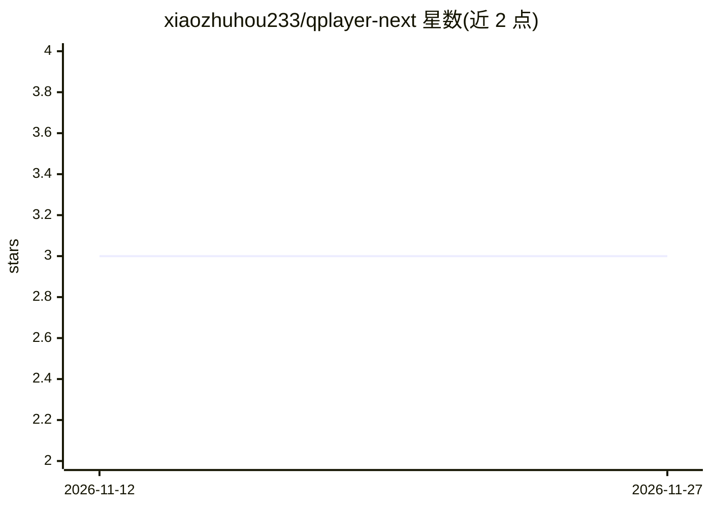

# xiaozhuhou233/qplayer-next

⭐ 3 · Java · Apache-2.0 · 推送 2026-11-01 · [GitHub](https://github.com/xiaozhuhou233/qplayer-next) · 个人维护 · 中文 README

**为 Android 用户提供集成 AI 选曲与网易云/B站音源的音乐播放器**

QPlayer Next 是 QPlayer 的 Android Jetpack Compose / Material 3 Expressive 源码分支，将网易云音乐、本地音乐、B 站音视频与 AI 选曲集成在同一播放器中，提供 MD3E、经典 Material、Claude、iOS 四种视觉模式。功能包括扫码登录、歌词与 MV 播放、自动混音、听歌统计。AI 部分涵盖音乐对话生成可播放歌单、每日 AI 歌单与实验性 AI DJ；AI 功能需自行配置兼容 API 地址、模型与 Key，播放器功能不依赖 AI 配置。通过 Gradle 从源码构建，需 JDK 17 与 Android SDK 35。

## 筛选速览

| 维度 | 判定 | 备注 |
|---|---|---|
| AI 角色 | `ai-enhanced` | 去掉 AI 部分产品仍成立 |
| 许可风险 | `permissive` | Apache-2.0 |
| 部署形态 | `None` |  |
| 模型依赖 | — | README 未给出锁定关系 |
| 硬件要求 | — | 无带数字的原话,不猜 |
| 安装摩擦 | `medium` | 含编译或系统依赖之一 |
| 成熟度 | — | 结构信号不足 |

## 能力要点

- AI 音乐对话逐句回答并生成可播放歌单卡片
- 每日 AI 歌单结合听歌历史生成三组 20–30 首歌单
- 网易云、本地音乐与 B 站音视频多源播放
- 四种视觉模式，支持深浅主题与动态取色

## 适用场景

- 在 Android 上统一播放网易云、本地与 B 站音源
- 用对话描述场景与口味，生成可播放的歌单
- 逐字歌词与 MV 循环背景的播放体验

## 场景标签

`聊天机器人` · 领域:对话与助手

## 证据(README 行号)

> L11: QPlayer Next 是 QPlayer 的 Android Compose / MD3E 源码分支。它把网易云音乐、本地音乐、B 站音视频与 AI 选曲放进同一个播放器，提供 Material 3 Expressive、经典
> L40: - **AI 音乐对话**：所有视觉模式均可点击 AI 输入框进入对话页，用文字描述场景、口味和修改需求；回答逐句呈现，直接生成可播放的歌单卡片。对话可保存到本地，从右侧历史列表恢复继续，后续建议随 AI 回答生成。
> L49: AI 功能需要自行配置兼容的 API 地址、模型与 Key；播放器功能不要求配置 AI。

## 星数曲线

2026-11-12 3 → 2026-11-27 3（+0）

---
*卡片 v1 · prompt 1.4 · 生成 2026-11-21 · 置信度 high · 依据 README sha `7b70305a1c60` · [字段定义](../../DATASET.md)*
