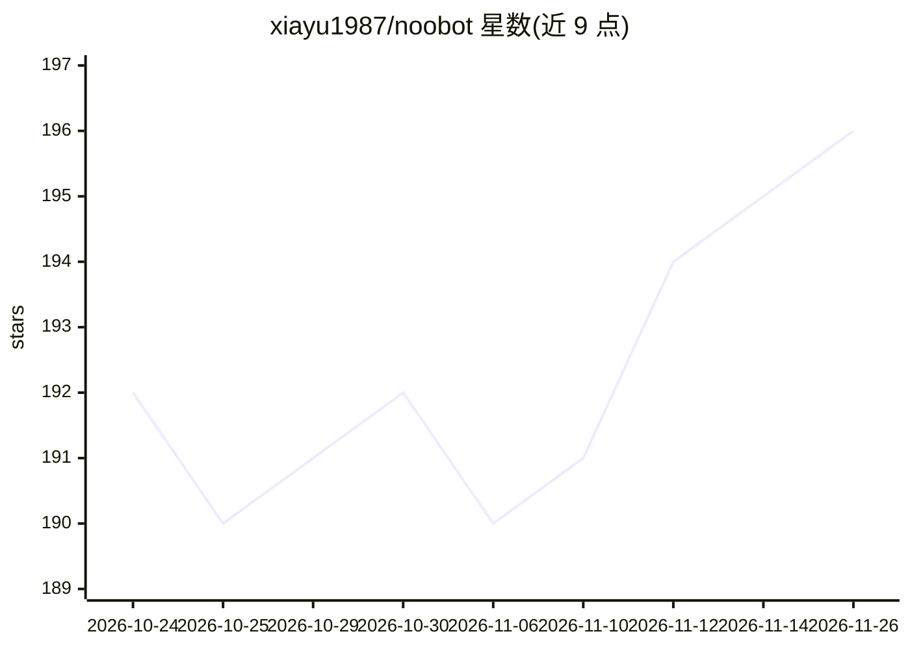

# xiayu1987/noobot

⭐ 196 · JavaScript · MIT · 推送 2026-11-24 · [GitHub](https://github.com/xiayu1987/noobot) · 个人维护 · 中文 README

**自托管 AI agent 工作台：工具调用、多模型路由与 3D 角色动画生成**

基于 Node.js、Vue 3 与 Electron 的开源 Web/桌面 AI agent 应用，提供多用户隔离工作区、持久会话、可扩展工具（文件操作、脚本执行、浏览器自动化、LibreOffice、FFmpeg）、MCP 连接器、多 agent 编排与 OpenAI 兼容的多模型路由。特色功能是通过自然语言导入 3D 角色并生成、预览与迭代角色动画（Three.js 渲染，无需动画代码），动画以会话作品保存。提供 Windows 安装包、macOS 包与 Linux/macOS 服务器自托管脚本，执行隔离支持 Docker 沙箱或主机直跑两种模式。

## 筛选速览

| 维度 | 判定 | 备注 |
|---|---|---|
| AI 角色 | `ai-native` | 本体是模型或模型工具 |
| 许可风险 | `permissive` | MIT |
| 部署形态 | `desktop` | 安装包/桌面程序 |
| 模型依赖 | — | README 未给出锁定关系 |
| 硬件要求 | — | 无带数字的原话,不猜 |
| 安装摩擦 | `medium` | 含编译或系统依赖之一 |
| 成熟度 | — | 结构信号不足 |

## 能力要点

- 多 agent 编排：任务委派、语义工作流与工作流插件
- OpenAI 兼容 provider 接口与模型族路由、工具调用、流式输出
- 自然语言生成 3D 角色动画（Three.js 渲染，GLB 导入）
- 命令行 noobot 支持会话恢复与 json/stream-json 输出

## 适用场景

- 自托管部署一个多用户 AI agent 工作台
- 用一句话生成并迭代 3D 角色动画
- 通过 MCP 与连接器让 agent 操作数据库、终端、邮件

## 场景标签

`模型网关` `多智能体` `浏览器自动化` `AI 助手` · 领域:Agent 开发

## 证据(README 行号)

> L18: Noobot is an open-source Web and desktop AI agent application built with Node.js, Vue 3, and Electron. It provides 
> L62: - **AI character animation:** import 3D characters and use natural language to create, preview, and refine solo or 

## 星数曲线

2026-10-24 192 → 2026-11-26 196（+4）

---
*卡片 v1 · prompt 1.4 · 生成 2026-11-25 · 置信度 high · 依据 README sha `e46c774ff6bd` · [字段定义](../../DATASET.md)*
