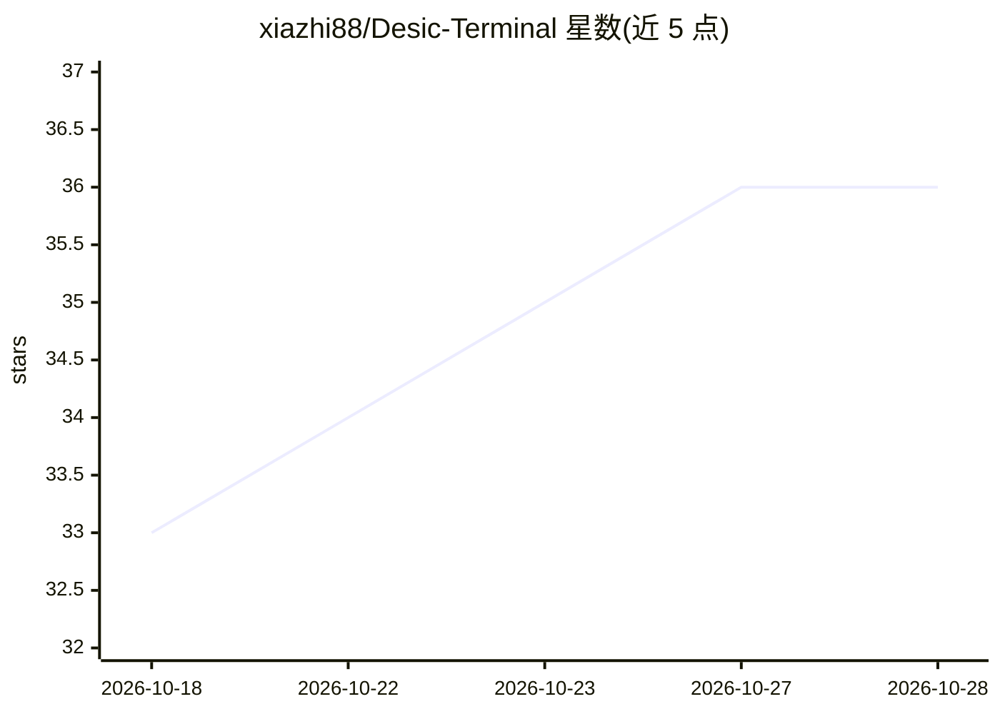

# xiazhi88/Desic-Terminal

⭐ 36 · Rust · MIT · 推送 2026-10-07 · [GitHub](https://github.com/xiazhi88/Desic-Terminal) · [官网](https://desicterminal.com/) · 个人维护 · 中文 README

**对接 OKX 永续的开源 AI 量化交易桌面工作台**

基于 Tauri 2 / Rust / React 的桌面应用，面向 OKX USDT 永续合约交易者：提供多周期 K 线与 24 个指标的图表、限价/市价/计划委托与止盈止损、全市场雷达扫描、市场情报聚合，以及 Python 策略回测（最长 366 天 1 分钟级）。AI 部分：交易助手读取账户与市场证据输出决策、多 Agent 协作编排、三种权限模式（advisor/copilot/limited_auto）由代码层风控闸门约束。支持 10 家模型供应商与本机 Codex CLI / Claude Code 通道。仅支持 OKX，不支持现货、期权与移动端；安装包未签名；API Key 本地明文存储。

## 筛选速览

| 维度 | 判定 | 备注 |
|---|---|---|
| AI 角色 | `ai-enhanced` | 去掉 AI 部分产品仍成立 |
| 许可风险 | `permissive` | MIT |
| 部署形态 | `library` | 以包/库形式分发 |
| 模型依赖 | locked-api |  |
| 硬件要求 | — | 无带数字的原话,不猜 |
| 安装摩擦 | `low` | 无编译、无系统依赖或容器化 |
| 成熟度 | `idea` | |

## 能力要点

- advisor/copilot/limited_auto 三档 AI 权限模式，权限由代码而非提示词决定
- OKX 全市场雷达扫描与可复现研究工作流（点时验证、评分归因）
- 免安装 Python 的策略回测（最长 366 天 1 分钟级）与参数调优工作台
- 支持 10 家模型供应商，可用本机已登录的 Codex CLI / Claude Code 免购 API Key

## 适用场景

- 在一个桌面界面里完成 OKX 永续合约的看盘、下单与持仓管理
- 让 AI 在代码约束的权限内辅助或自动执行交易
- 用 Python 策略回测与参数调优做系统化交易研究
- 扫描全市场强弱以确定下一步研究顺序

## 场景标签

`金融量化` `多智能体` `AI 助手` · 领域:Agent 开发

## 证据(README 行号)

> L19:  开源的 AI 量化交易工作台（对接 OKX）
> L20:  Windows / macOS 桌面应用：看盘、下单、AI 交易助手、带风控闸门的 AI 自动交易与 Python 策略回测，共用一份实时状态与审计链路。
> L111: 权限不是提示词。模式决定 AI 能做什么，代码决定它做不到什么。
> L201: |**Desic Terminal**|桌面图形终端（Tauri / Rust / React）|在一个界面里完成 OKX 永续的看盘、下单和策略研究，并让 AI 在代码约束的权限内辅助或执行|

## 星数曲线

2026-10-18 33 → 2026-10-28 36（+3）

---
*卡片 v1 · prompt 1.4 · 生成 2026-10-25 · 置信度 high · 依据 README sha `19de51723dd1` · [字段定义](../../DATASET.md)*
