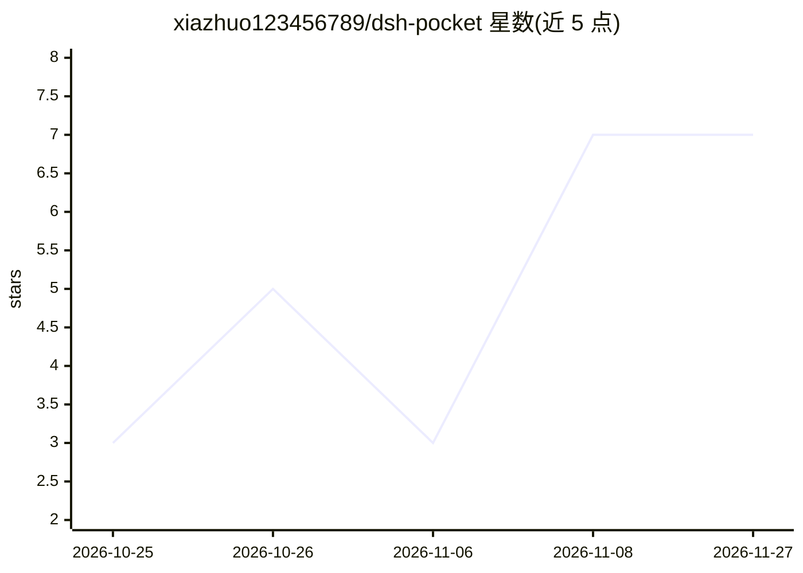

# xiazhuo123456789/dsh-pocket

⭐ 7 · Kotlin · MIT · 推送 2026-10-24 · [GitHub](https://github.com/xiazhuo123456789/dsh-pocket) · 个人维护 · 中文 README

**手机远程控制 DeepSeek Harness 的 Android 客户端**

DSH Pocket 是一款 Android 应用，通过 HTTPS/WSS 与电脑上的 DeepSeek Harness 配对后，可在手机上提交自然语言任务、查看流式回复与实时状态、停止任务、处理审批请求，并接收完成与审批通知。模型推理与文件操作全部留在电脑端，手机只发送任务与传递决定。另内置从桌面插件 dsh-pet 搬入的「大肥鱼」桌宠，106 段动画随 APK 离线可用，不连电脑也能运行。从 Releases 下载 APK 安装，也可从源码构建；桌宠素材以 CC BY-NC-SA 4.0 授权、不可商用，App 只做免费分发。

## 筛选速览

| 维度 | 判定 | 备注 |
|---|---|---|
| AI 角色 | `ai-ecosystem` | LLM/agent 周边工具 |
| 许可风险 | `permissive` | MIT |
| 部署形态 | `None` |  |
| 模型依赖 | locked-api |  |
| 硬件要求 | — | 无带数字的原话,不猜 |
| 安装摩擦 | `medium` | 含编译或系统依赖之一 |
| 成熟度 | — | 结构信号不足 |

## 能力要点

- 扫码/粘贴链接配对，远程提交任务、查看流式回复与审批
- 状态语义承诺：已发送/已停止/连不上均以电脑回执为准
- 模型与权限选择器读自电脑投影，支持多模型与三档权限
- 内置大肥鱼桌宠：106 段动画、12,659 帧、离线可用、可悬浮于其他应用

## 适用场景

- 离开电脑时用手机给 DeepSeek Harness 发任务并盯进度
- 在通知里一键处理电脑上的工具审批请求
- 手机上养一只离线的桌面宠物

## 场景标签

`AI 助手` · 领域:对话与助手

## 证据(README 行号)

> L15: > **这是什么**：DSH Pocket 是一款 Android 应用。配对之后，你可以用手机向电脑上的
> L188: DSH Pocket **不实现自己的协议**。它复用 DeepSeek Harness 已经提供的远程控制面：
> L193: |之后所有调用|`/remote/api/*`，凭据放在 `x-dsh-remote-device`|

## 星数曲线

2026-10-25 3 → 2026-11-27 7（+4）

---
*卡片 v1 · prompt 1.4 · 生成 2026-11-20 · 置信度 mid · 依据 README sha `a45d1553daa9` · [字段定义](../../DATASET.md)*
