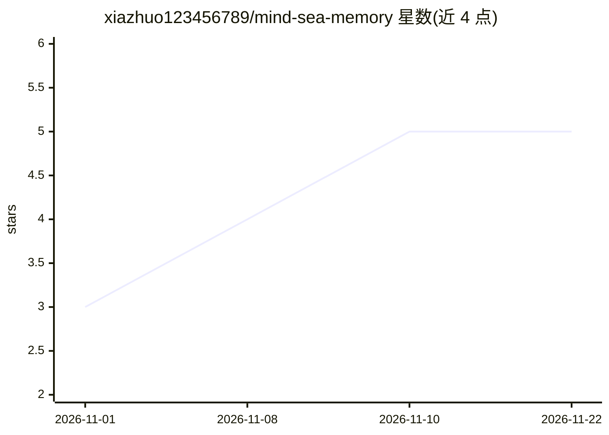

# xiazhuo123456789/mind-sea-memory

⭐ 5 · JavaScript · MIT · 推送 2026-11-02 · [GitHub](https://github.com/xiazhuo123456789/mind-sea-memory) · 个人维护 · 中文 README

**给任意 AI QQ 机器人的跨会话长期记忆层**

以 HTTP 服务与 MCP 工具两种形式提供的记忆引擎：每轮对话自动检索相关记忆注入 system prompt、自动把值得记的内容写回，支持五类记忆加元记忆、owner/visibility 用户与场合隔离、间隔重复衰减与分层遗忘、夜间整理定时任务。零外部依赖，纯 Node 内置模块实现，自带力导向 3D 记忆可视化面板。接入路径覆盖 DSH MCP 注册、OpenAI 兼容代理与裸 HTTP API 三条路线。不配 LLM 时记忆抽取走规则兜底。

## 筛选速览

| 维度 | 判定 | 备注 |
|---|---|---|
| AI 角色 | `ai-ecosystem` | LLM/agent 周边工具 |
| 许可风险 | `permissive` | MIT |
| 部署形态 | `None` |  |
| 模型依赖 | — | README 未给出锁定关系 |
| 硬件要求 | — | 无带数字的原话,不猜 |
| 安装摩擦 | `low` | 无编译、无系统依赖或容器化 |
| 成熟度 | — | 结构信号不足 |

## 能力要点

- OpenAI 兼容代理模式：自动检索注入与自动写回，每轮注入预算恒定（≤1400 字节）
- owner + visibility 双重隔离，private 记忆在群聊场合召不回（引擎级而非提示词级）
- 注册为 DSH 的 MCP 服务器，提供 mem_recall / mem_remember / mem_stats 工具
- 零依赖单文件部署，自带力导向'大脑'可视化面板与夜间整理脚本

## 适用场景

- 给 QQ 聊天机器人加上跨会话记住用户偏好与约定的能力
- 群聊场景下隔离不同用户和群的记忆，防止串记忆
- 用可视化面板查看和管理机器人的记忆库
- 已用 DSH 的用户通过 MCP 工具让 AI 主动回忆和记录

## 场景标签

`Agent 记忆` · 领域:Agent 开发

## 证据(README 行号)

> L3: > **记忆星海**：给**任何 AI 机器人**的跨会话长期记忆 + 3D 记忆星海可视化。不绑定某一款机器人——SnowLuma / NapCat / qq-bridge / SurfCore / DSH / AstrBot，能
> L139: 本引擎是**链路无关**的：只要能发 HTTP 或被注册为 MCP，任何 QQ 机器人框架都能获得记忆。

## 星数曲线

2026-11-01 3 → 2026-11-22 5（+2）

---
*卡片 v1 · prompt 1.4 · 生成 2026-11-21 · 置信度 high · 依据 README sha `aaa2e76675ec` · [字段定义](../../DATASET.md)*
