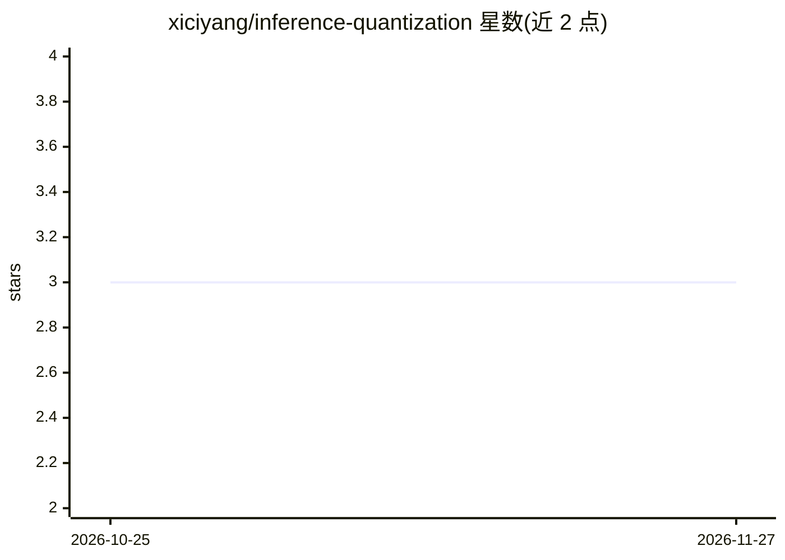

# xiciyang/inference-quantization

⭐ 3 · JavaScript · MIT · 推送 2026-10-20 · [GitHub](https://github.com/xiciyang/inference-quantization) · [官网](https://xiciyang.com/blog/fix-the-instrument-first/) · 个人维护

**给 LLM 量化流程加双门禁与审计签收的 DSH 插件**

作为 DSH 插件/CLI 运行的模型量化验证层：对 checkpoint 做 PTQ（默认 AWQ+INT4，经 llmcompressor 在容器内执行），随后过两条独立门禁——去泄漏切分上的困惑度增量精度门禁，以及检查均匀输出、无区分力等无效测量的测量成立性门禁。内置 5 级有界降级链（INT4→INT8→FP8→W8A16→仅出 QAT 计划）、哈希链审计日志与回滚命令。面向需要显式失败结论而非静默通过的量化工程师；通过 MCP 经 inference-serving 的真实端点测性能。

## 筛选速览

| 维度 | 判定 | 备注 |
|---|---|---|
| AI 角色 | `ai-ecosystem` | LLM/agent 周边工具 |
| 许可风险 | `permissive` | MIT |
| 部署形态 | `library` | 以包/库形式分发 |
| 模型依赖 | — | README 未给出锁定关系 |
| 硬件要求 | — | 无带数字的原话,不猜 |
| 安装摩擦 | `low` | 无编译、无系统依赖或容器化 |
| 成熟度 | — | 结构信号不足 |

## 能力要点

- 去泄漏门禁：校准/测试集内容 sha256 交集必须为空，无人工放行通道
- 测量成立性门禁：均匀输出/无区分力等以 E_MEASUREMENT_INVALID 显式失败
- 5 级有界降级链与哈希链审计，最高档只出 QAT 计划不执行训练
- 零运行时依赖（仅 Node 内建模块），源模型只读+前后哈希校验

## 适用场景

- 量化 LLM checkpoint 后需要独立精度/性能门禁签收
- 防范截断或损坏模型被量化后误报零精度损失
- 为量化运行生成可审计的哈希链证据链
- 需要回滚量化产出并保护源模型目录

## 场景标签

`模型量化` `模型评测` · 领域:评测与运维

## 证据(README 行号)

> L3: **Quantize a model and prove it — or get an explicit failure.** Give it a checkpoint, an accuracy
> L22: **Not a fit if** you just want `llmcompressor` or AutoAWQ recipes — those do the quantization; this
> L85: **依赖**：`inference-serving`（部署验证，通过 **MCP** 调用）。本插件用下列顺序定位它：

## 星数曲线

2026-10-25 3 → 2026-11-27 3（+0）

---
*卡片 v1 · prompt 1.4 · 生成 2026-11-21 · 置信度 mid · 依据 README sha `0e625fb4a08e` · [字段定义](../../DATASET.md)*
