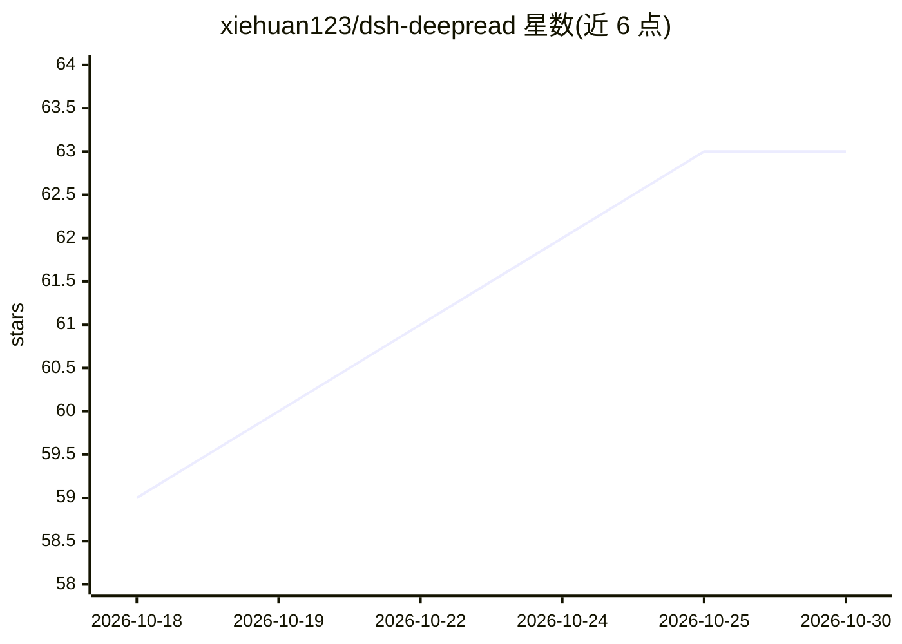

# xiehuan123/dsh-deepread

⭐ 63 · JavaScript · MIT · 推送 2026-09-11 · [GitHub](https://github.com/xiehuan123/dsh-deepread) · [官网](https://xiehuan123.github.io/dsh-deepread/) · 个人维护 · 中文 README

**面向 AI agent 的证据优先深度阅读技能/插件**

以两种形态提供：零依赖的可移植 Agent Skill（供 Codex、Claude Code 等 Agent Skills 兼容工具使用，由 agent 自身的文件与联网工具执行证据优先阅读流程）与 DeepSeek Harness Web/headless 及 dsh-TUI 的宿主插件包（提供 deepread 工具、PDF 抽取、可选持久化/后台任务/Web 面板）。功能覆盖五种阅读模式（quick/deep/map/feynman/book）、声明-证据配对与页码定位、批量跨文档对比、成本预估与导出（md/FreeMind/HTML）。要求 Node.js 22.19 或 24 及以上。

## 筛选速览

| 维度 | 判定 | 备注 |
|---|---|---|
| AI 角色 | `ai-ecosystem` | LLM/agent 周边工具 |
| 许可风险 | `permissive` | MIT |
| 部署形态 | `library` | 以包/库形式分发 |
| 模型依赖 | — | README 未给出锁定关系 |
| 硬件要求 | — | 无带数字的原话,不猜 |
| 安装摩擦 | `low` | 无编译、无系统依赖或容器化 |
| 成熟度 | — | 结构信号不足 |

## 能力要点

- 五种模式：quick/deep/map/feynman（11 步循环+间隔复习）/book
- 声明配对证据与页/段出处，无证据声明被标注为不可验证
- 纯 JS PDF 抽取（含中文 ToUnicode 映射）与 2-10 篇批量对比
- token 成本预估、逐页解析进度流、后台任务与取消

## 适用场景

- 让 Codex/Claude Code 按 evidence-first 流程精读文章或 PDF
- 引用前做事实核查：核验文中数字与声明是否有来源
- 整本书的费曼式学习与跨文档对比分析

## 场景标签

`文档问答` `科研工具` · 领域:知识与检索

## 证据(README 行号)

> L18: - **Portable Agent Skill** for Codex, Claude Code, and other Agent Skills-compatible tools. Zero runtime dependenci
> L19: - **Host plugin package** for DeepSeek Harness Web/headless and dsh-TUI, with a `deepread` tool, PDF extraction, op

## 星数曲线

2026-10-18 59 → 2026-10-30 63（+4）

---
*卡片 v1 · prompt 1.4 · 生成 2026-10-24 · 置信度 high · 依据 README sha `d66f62aeab07` · [字段定义](../../DATASET.md)*
