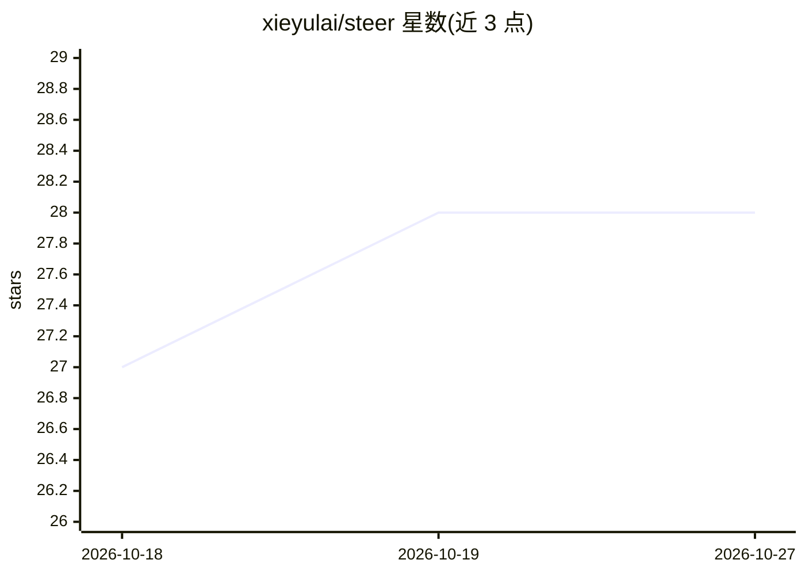

# xieyulai/steer

⭐ 28 · Python · Apache-2.0 · 推送 2026-10-14 · [GitHub](https://github.com/xieyulai/steer) · [官网](https://github.com/xieyulai/steer) · 个人维护 · 中文 README

**AI4R 自主实验治理框架：冻结任务与评分，agent 只改实现**

面向自动/自主科研（AI for Research）的实验治理模板框架：用户把已有训练项目接入，冻结任务、数据边界、主指标、评测器与时间预算为 contract；agent 仅在 workspace 写代码并多轮搜索，scoreboard 记录每轮 diff/日志/分数，最后经审计由人盖章 keep/park/reject。通过 install.sh 把 17 个技能安装到 ~/.cursor/skills 与 ~/.claude/skills，在 Cursor 或 Claude Code 中以斜杠命令驱动五步循环（打分原仓库→接入→设下界与公开对照→搜索→审计）。支持监督学习、强化学习、物理约束训练等多范式场景示例。

## 筛选速览

| 维度 | 判定 | 备注 |
|---|---|---|
| AI 角色 | `ai-ecosystem` | LLM/agent 周边工具 |
| 许可风险 | `permissive` | Apache-2.0 |
| 部署形态 | `library` | 以包/库形式分发 |
| 模型依赖 | — | README 未给出锁定关系 |
| 硬件要求 | — | 无带数字的原话,不猜 |
| 安装摩擦 | `low` | 无编译、无系统依赖或容器化 |
| 成熟度 | — | 结构信号不足 |

## 能力要点

- 冻结任务/评分器/证据的 contract 治理机制，agent 不可改考卷
- 17 个技能以斜杠命令运行（/auto-nn-init、/auto-nn-auto-run、/auto-nn-audit 等）
- 每轮保留 diff、日志与分数的 scoreboard，按 scenario 分列
- 审计含复现、多种子与消融，结论由人决定 keep/park/reject

## 适用场景

- 把我已有的训练仓库接入，让 agent 在治理下自主搜索更优实现
- 为自主实验设置朴素下界与公开对照两条基准线
- 对当前最优结果做复现/多种子/消融审计后再采纳

## 场景标签

`编码 Agent` `模型评测` `科研工具` · 领域:编码与开发

## 证据(README 行号)

> L3:  STEER (Steerable and Traceable autonomous Experimentation for Evidence-governed AI Research) is an AI4R (AI for Res
> L20: That fence is **governance**: the agent searches; the task, the official test, and the evidence stay yours. Health 
> L62: Skills are **linked** into `~/.cursor/skills/` and `~/.claude/skills/`. Your experiment project does not get a copy

## 星数曲线

2026-10-18 27 → 2026-10-27 28（+1）

---
*卡片 v1 · prompt 1.4 · 生成 2026-10-26 · 置信度 mid · 依据 README sha `d01f3d95c4a1` · [字段定义](../../DATASET.md)*
