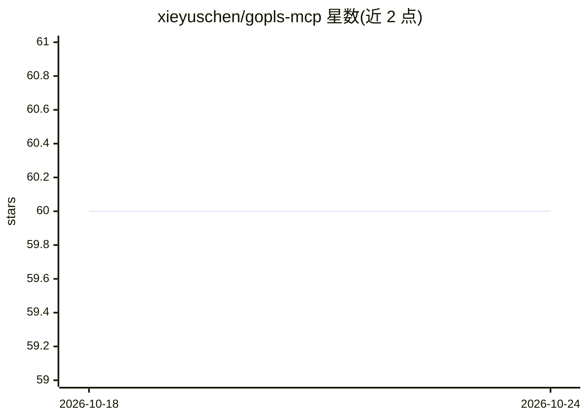

# xieyuschen/gopls-mcp

⭐ 60 · Go · BSD-3-Clause · 推送 2026-10-18 · [GitHub](https://github.com/xieyuschen/gopls-mcp) · [官网](https://gopls-mcp.org) · 个人维护

**为 AI 编码代理提供 Go 语义分析能力的 MCP 服务器**

基于 gopls 分叉构建的 MCP server，向 LLM 提供类型检查级别的 Go 语义分析：解析接口实现、跨包标识、遮蔽作用域，支持查找接口的具体实现类型、追踪调用层级、映射包依赖等任务。文档称在 11 项语义任务基准中比基于 grep 的导航使用更少工具调用。面向使用 Claude Code、Codex 等 AI 编码代理的 Go 开发者，提供插件安装与多平台脚本安装两种方式。社区维护，非 Go 官方产品，沿用上游 BSD 许可。

## 筛选速览

| 维度 | 判定 | 备注 |
|---|---|---|
| AI 角色 | `ai-ecosystem` | LLM/agent 周边工具 |
| 许可风险 | `permissive` | BSD-3-Clause |
| 部署形态 | `None` |  |
| 模型依赖 | — | README 未给出锁定关系 |
| 硬件要求 | — | 无带数字的原话,不猜 |
| 安装摩擦 | `low` | 无编译、无系统依赖或容器化 |
| 成熟度 | — | 结构信号不足 |

## 能力要点

- 向 LLM 提供编译器精度的 Go 类型系统语义分析
- 支持接口实现查找、调用层级追踪、包依赖映射
- 提供 Claude Code 与 Codex 插件式安装及跨平台安装脚本

## 适用场景

- 让 AI 编码代理理解 Go 项目的类型与调用结构
- 在大型 Go 代码库中做语义级导航而非文本搜索
- 为 Claude Code/Codex 等 agent 接入 Go 静态分析能力

## 场景标签

 · 领域:开发工具/静态分析

## 证据(README 行号)

> L7: gopls-mcp delivers type-checker-level semantic analysis directly to your LLM.
> L14: ### Claude Code (plugin — recommended)

## 星数曲线

2026-10-18 60 → 2026-10-24 60（+0）

---
*卡片 v1 · prompt 1.4 · 生成 2026-10-24 · 置信度 high · 依据 README sha `a78e3758e910` · [字段定义](../../DATASET.md)*
