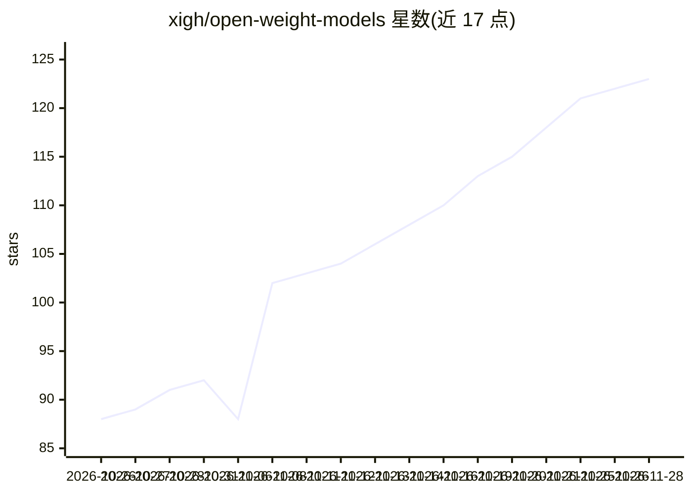

# xigh/open-weight-models

⭐ 123 · Python · NOASSERTION · 推送 2026-10-29 · [GitHub](https://github.com/xigh/open-weight-models) · [官网](https://philippe-anel.fr/en/blog/2026/04/04/panorama-llm-open-source-2026/) · 个人维护

**可商用许可开源权重模型策展清单：筛选与基准核验**

由 Philippe Anel 维护的开源权重模型清单，收录许可证允许商业使用、无地域限制、Q4 量化显存占用不超过 128GB（扩展档至 256GB）、2024 年 4 月后发布的模型。条目以表格形式列出发布方、参数量、架构、上下文长度、许可证与基准分数，并按通用、代码、紧凑/边缘、视觉、定理证明等类别组织。配套 ROOTS.md 与 tools/hf_roots.py 从 Hugging Face 跟踪各实验室发布的根模型作为候选池；清单服务于其自研 Rust 推理引擎 herbert-rs 的模型选型。

## 筛选速览

| 维度 | 判定 | 备注 |
|---|---|---|
| AI 角色 | `ai-knowledge` | 知识聚合/清单类 |
| 许可风险 | `none` | NOASSERTION |
| 部署形态 | `None` |  |
| 模型依赖 | — | README 未给出锁定关系 |
| 硬件要求 | `gpu-8g` | |
| 安装摩擦 | `medium` | 含编译或系统依赖之一 |
| 成熟度 | — | 结构信号不足 |

## 能力要点

- 三条收录标准：可商用许可、VRAM Q4 ≤ 128 GB（扩展档 ≤ 256 GB）、2024 年 4 月后发布
- 表格条目含发布方/参数量/架构/许可证/基准分数
- ROOTS.md 与 hf_roots.py 工具跟踪 Hugging Face 根模型发布
- 对 Modified MIT 等带收入/MAU 限制的许可证给出显式警告

## 适用场景

- 为本地推理引擎选型可商用的开源权重模型
- 按显存预算（128/256 GB Q4）筛选可运行模型
- 跟踪各实验室最新发布的根模型

## 场景标签

`精选清单` · 领域:学习与行业

## 证据(README 行号)

> L1: # Open Weight Models
> L3: A curated list of open-weight AI models with commercially exploitable licenses, verified benchmarks, and no geograph
> L5: **Selection criteria:**

## 星数曲线

2026-10-26 88 → 2026-11-28 123（+35）

---
*卡片 v1 · prompt 1.4 · 生成 2026-11-28 · 置信度 high · 依据 README sha `93983e65ff09` · [字段定义](../../DATASET.md)*
