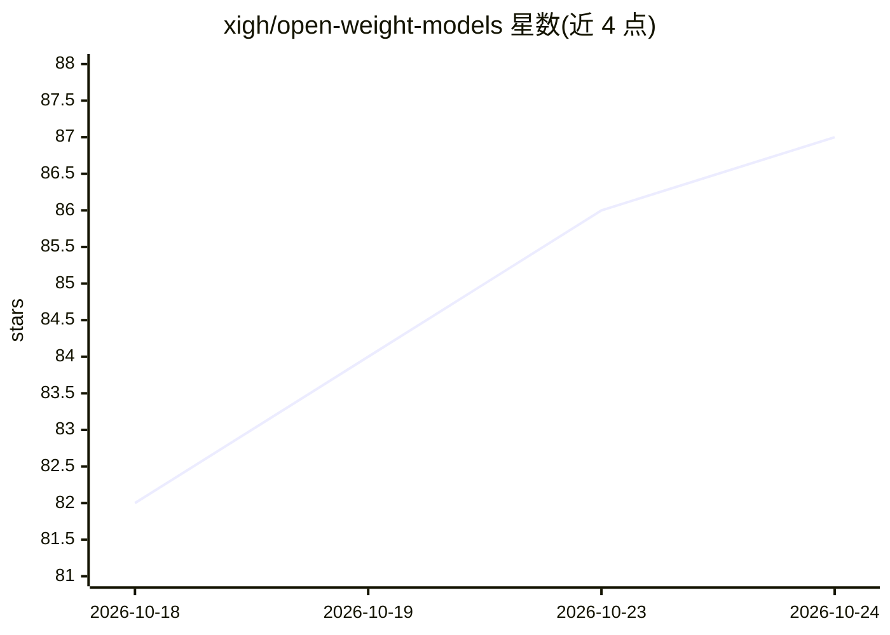

# xigh/open-weight-models

⭐ 88 · NOASSERTION · 推送 2026-06-04 · [GitHub](https://github.com/xigh/open-weight-models) · [官网](https://philippe-anel.fr/en/blog/2026/04/04/panorama-llm-open-source-2026/) · 个人维护

**可商用许可开放权重模型的策展清单，按硬件门槛筛选**

由个人维护的开放权重 AI 模型精选清单：以「许可可商用且无地域限制、Q4 量化 VRAM ≤ 128 GB、2024 年 4 月后发布」为入选标准，设 128–256 GB 扩展档；按通用、代码、推理、紧凑/边缘等类别组织条目，列出发布方、参数规模、架构、上下文长度、许可与基准分数，并附被排除模型的说明。作者声明该清单用于为其 Rust 本地推理引擎 herbert-rs 决定支持哪些模型。条目另附各基准（SWE-bench、GPQA、AIME 等）的测量口径说明与许可警示（如带收入/MAU 上限的 Modified MIT）。

## 筛选速览

| 维度 | 判定 | 备注 |
|---|---|---|
| AI 角色 | `ai-knowledge` | 知识聚合/清单类 |
| 许可风险 | `none` | NOASSERTION |
| 部署形态 | `None` |  |
| 模型依赖 | — | README 未给出锁定关系 |
| 硬件要求 | — | 无带数字的原话,不猜 |
| 安装摩擦 | `medium` | 含编译或系统依赖之一 |
| 成熟度 | — | 结构信号不足 |

## 能力要点

- 三条入选标准：可商用许可（EU 可用）、Q4 VRAM ≤ 128 GB、2024 年 4 月后发布
- 附 128–256 GB 扩展档与被排除模型（Llama 4 多模态、DeepSeek V3/R1 全量等）说明
- 覆盖通用/代码/推理/数学/紧凑边缘等类别，含基准口径注释与许可风险警示
- 清单用途：为 Rust 本地推理引擎 herbert-rs 的模型支持决策服务

## 适用场景

- 在 128 GB 显存工作站预算内挑选可商用的开放权重模型
- 对比各模型在 SWE-bench、GPQA、AIME 等基准上的分数
- 识别带收入/MAU 上限的许可陷阱，规避商用风险

## 场景标签

`精选清单` · 领域:学习与行业

## 证据(README 行号)

> L3: A curated list of open-weight AI models with commercially exploitable licenses, verified benchmarks, and no geograph
> L8: 2. **VRAM Q4 ≤ 128 GB** (main) — what fits Q4-quantized on a single high-end workstation. An **extended tier** (128 
> L21: ## Table of Contents

## 星数曲线

2026-10-18 82 → 2026-10-24 87（+5）

---
*卡片 v1 · prompt 1.4 · 生成 2026-10-23 · 置信度 high · 依据 README sha `8cd89f41c6f2` · [字段定义](../../DATASET.md)*
