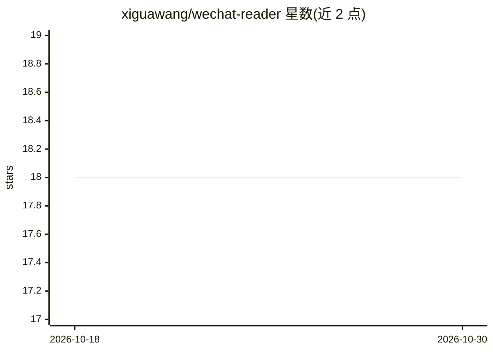

# xiguawang/wechat-reader

⭐ 18 · Python · MIT · 推送 2026-09-03 · [GitHub](https://github.com/xiguawang/wechat-reader) · 个人维护 · 中文 README

**给 AI Agent 可靠读取微信公众号文章的 CLI/MCP/Python 工具**

面向 AI agent 与自动化流程的微信公众号文章读取工具，提供 CLI、stdio MCP server 与 Python API 三种入口。核心机制是复用用户已登录、已验证的真实浏览器会话，通过 attach/launch/playwright/auto 四种策略读取页面，返回 ok、captcha_required、rate_limited 等结构化状态，需人工验证时通知 agent 请求用户操作而非静默失败。可解包微信验证包装链接。README 明确声明不承诺稳定绕过微信风控，部分链接仍需用户手动验证。需 Python 3.11+ 与 Chromium。

## 筛选速览

| 维度 | 判定 | 备注 |
|---|---|---|
| AI 角色 | `ai-ecosystem` | LLM/agent 周边工具 |
| 许可风险 | `permissive` | MIT |
| 部署形态 | `library` | 以包/库形式分发 |
| 模型依赖 | — | README 未给出锁定关系 |
| 硬件要求 | — | 无带数字的原话,不猜 |
| 安装摩擦 | `low` | 无编译、无系统依赖或容器化 |
| 成熟度 | — | 结构信号不足 |

## 能力要点

- 复用已登录浏览器会话的四种读取策略（attach/launch/playwright/auto）
- 结构化状态返回（ok/captcha_required/rate_limited），避免静默失败
- 内置 MCP server，暴露 7 个工具供 Claude、Codex 等 MCP 宿主调用
- 自动解包微信验证包装链接到真实文章 URL

## 适用场景

- AI agent 工作流中处理微信文章链接（摘要、翻译、知识库入库）
- 内容监控或竞品分析流水线中稳定读取微信文章
- 自动化流程出现微信链接时接入 MCP server 做可靠读取

## 场景标签

`网页抓取` · 领域:效率与自动化

## 证据(README 行号)

> L3: 面向 AI Agent 的微信公众号阅读工具，提供 CLI、MCP server 和 Python API，可复用用户已登录、已验证的浏览器会话。
> L32: - `wechat-reader-mcp`：把同样的能力暴露给 Claude、Codex 等支持 MCP 的宿主
> L87: - 可直接接入 agent 的 MCP server

## 星数曲线

2026-10-18 18 → 2026-10-30 18（+0）

---
*卡片 v1 · prompt 1.4 · 生成 2026-10-29 · 置信度 mid · 依据 README sha `323e2718d6a1` · [字段定义](../../DATASET.md)*
