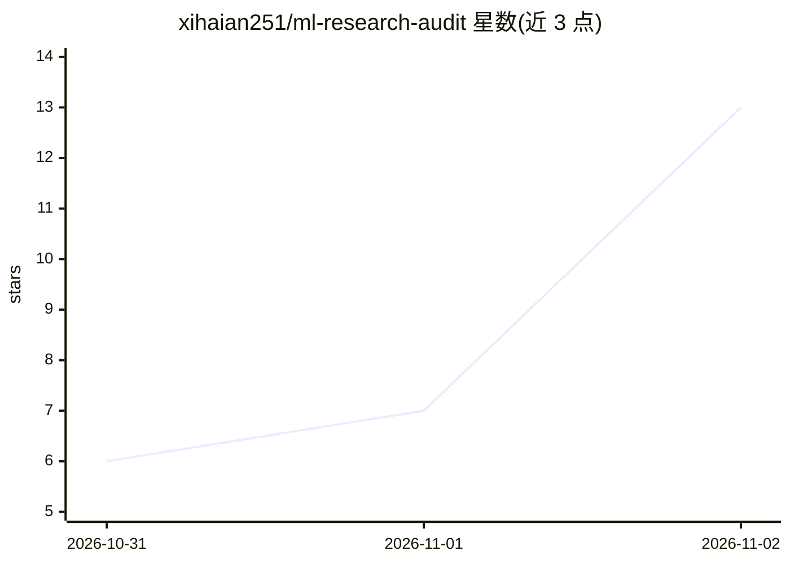

# xihaian251/ml-research-audit

⭐ 13 · Python · Apache-2.0 · 推送 2026-10-07 · [GitHub](https://github.com/xihaian251/ml-research-audit) · 个人维护 · 中文 README

**面向 ML 科研的端到端溯源审计工具栈门户（四个 Doctor CLI）**

本仓库是四个命令行审计工具（Dataset/Experiment/Result/Paper Doctor）的公开门户与总说明，自身不含源代码。四个工具分别审计数据集、实验运行、报告数值与论文声明四层，链路由声明的 manifest（如 paper-doctor.yml、experiment.lock.json）显式连接，不做推断式桥接，缺失证据保持 UNKNOWN/INCONCLUSIVE。各工具经 PyPI 以 pip 安装（dataset-doctor-audit / experiment-doctor / result-doctor / paper-doctor），Apache-2.0，Python 3.11+；README 附 TabM（ICLR 2025）四层链路验收记录与状态语义、退出码约定。面向需要核查论文结论可追溯性的科研人员与审稿者。

## 筛选速览

| 维度 | 判定 | 备注 |
|---|---|---|
| AI 角色 | `ai-ecosystem` | LLM/agent 周边工具 |
| 许可风险 | `permissive` | Apache-2.0 |
| 部署形态 | `library` | 以包/库形式分发 |
| 模型依赖 | — | README 未给出锁定关系 |
| 硬件要求 | — | 无带数字的原话,不猜 |
| 安装摩擦 | `low` | 无编译、无系统依赖或容器化 |
| 成熟度 | — | 结构信号不足 |

## 能力要点

- 四层独立审计：数据集→实验→结果→论文声明，链路全靠声明文件显式连接
- 明确不以 LLM 作裁判（L239），不做聚合评分，不判定论文真伪
- 五级规则状态（PASS/FAIL/INCONCLUSIVE/NOT_APPLICABLE/NOT_RUN）与证据分级
- 包含对第三方论文 TabM 的完整四层链路审计记录

## 适用场景

- 投稿或审稿前核查论文声明与证据链是否一致
- 检查评测数据集的划分边界、泄漏与重复问题
- 记录实验的 seed、config、代码版本以备溯源

## 场景标签

 · 领域:科研软件/ML 可复现性审计

## 证据(README 行号)

> L7: **End-to-end provenance auditing for machine-learning research.**
> L239: |Use a language model as a judge|a probabilistic reader cannot be the authority on whether a number matches a numb

## 星数曲线

2026-10-31 6 → 2026-11-02 13（+7）

---
*卡片 v1 · prompt 1.4 · 生成 2026-11-02 · 置信度 low · 依据 README sha `9f11c2e4f65a` · [字段定义](../../DATASET.md)*
