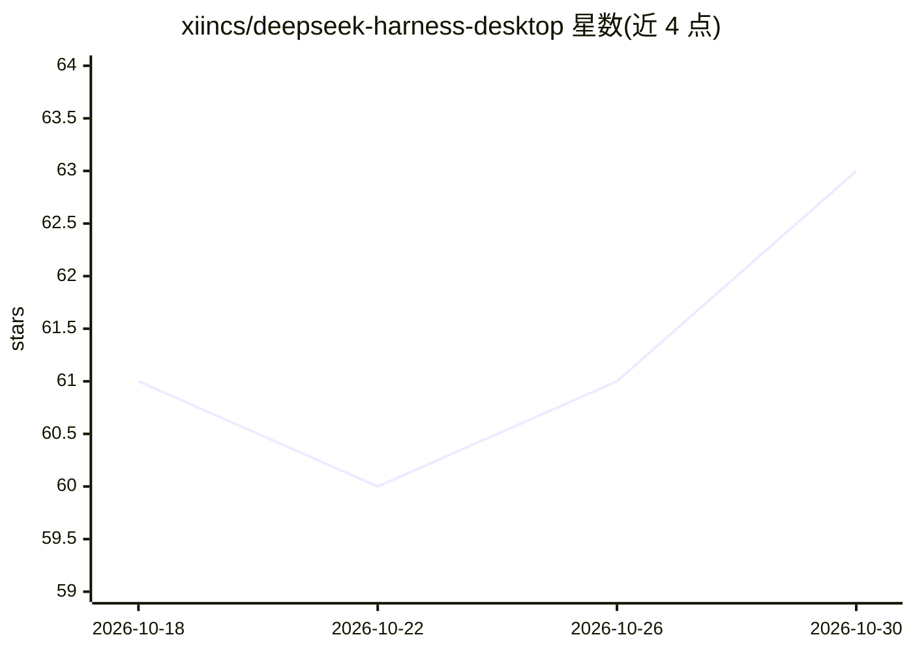

# xiincs/deepseek-harness-desktop

⭐ 63 · Rust · MIT · 推送 2026-09-21 · [GitHub](https://github.com/xiincs/deepseek-harness-desktop) · 组织维护 · 中文 README

**DeepSeek Harness 的社区桌面壳：托盘常驻、免命令行、带文件面板与插件市场**

基于 Tauri 2 的第三方桌面封装，把网页版 DeepSeek Harness 包成原生应用：内置 Node.js 运行时并自动准备后台服务，关闭窗口后驻留系统托盘继续运行，崩溃后自动重启，数据与网页版互通。附加文件目录树预览编辑、社区插件市场（安装前展示确切命令）、内置终端与自动更新。提供 Windows/macOS/Linux 安装包，macOS/Linux 暂不支持自动更新。

## 筛选速览

| 维度 | 判定 | 备注 |
|---|---|---|
| AI 角色 | `ai-ecosystem` | LLM/agent 周边工具 |
| 许可风险 | `permissive` | MIT |
| 部署形态 | `desktop` | 安装包/桌面程序 |
| 模型依赖 | — | README 未给出锁定关系 |
| 硬件要求 | — | 无带数字的原话,不猜 |
| 安装摩擦 | `low` | 无编译、无系统依赖或容器化 |
| 成熟度 | — | 结构信号不足 |

## 能力要点

- 内置 Node.js 运行时，免命令行一键运行后台服务
- 托盘常驻、关窗不退出、后台服务崩溃自动重启
- 文件面板支持目录树预览编辑与改动标色
- 插件市场浏览/搜索/安装社区插件，安装前展示确切命令

## 适用场景

- 不想守着浏览器标签页，把 DeepSeek Harness 当桌面应用常驻使用
- 在应用内直接预览和编辑工作目录文件
- 浏览并安装社区插件扩展 Harness 功能

## 场景标签

`AI 助手` · 领域:对话与助手

## 证据(README 行号)

> L3: **把 DeepSeek Harness 装进一个真正的桌面应用**
> L24: DeepSeek Harness 官方提供的是一个网页版工具——好用，但终究是浏览器里的一个标签页：不小心关错标签、
> L64: 不是。DeepSeek Harness 本体由官方维护，这个桌面壳是社区做的第三方封装，专门解决"网页版不方便"这一件事。

## 星数曲线

2026-10-18 61 → 2026-10-30 63（+2）

---
*卡片 v1 · prompt 1.4 · 生成 2026-10-24 · 置信度 high · 依据 README sha `876f8a6abf68` · [字段定义](../../DATASET.md)*
