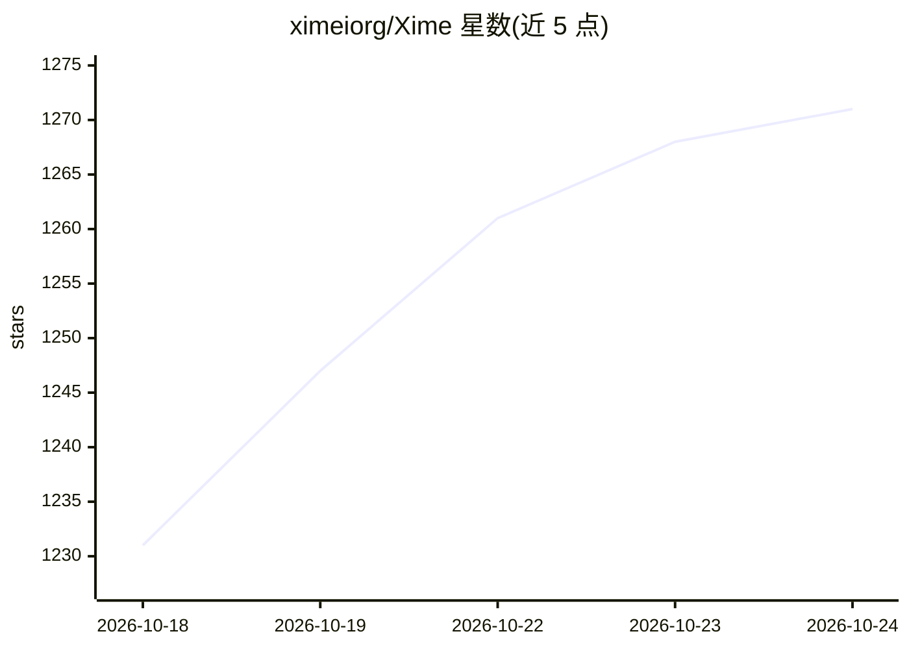

# ximeiorg/Xime

⭐ 1,271 · Kotlin · GPL-3.0 · 推送 2026-10-23 · [GitHub](https://github.com/ximeiorg/Xime) · [官网](https://ime.ximei.me) · 个人维护 · 中文 README

**基于 Rime 的安卓中文输入法，AI 提供预测与语音输入**

以 Rime（librime）为引擎的 Android 输入法，内置五笔 86/98、拼音及混输方案，支持通过方案市场或无线导入自定义方案（双拼、笔画等）。键盘布局覆盖全键盘、T9 拼音、笔画九键、手写、数字面板，另提供悬浮键盘、剪贴板管理与同步、Lua 插件市场。AI 部分：Transformer 预测文本、本地离线 ASR（zipformer2 流式引擎）及在线 ASR 插件（FunAsr、Volc 等）。要求 Android 9.0 及以上，GPLv3 许可。

## 筛选速览

| 维度 | 判定 | 备注 |
|---|---|---|
| AI 角色 | `ai-enhanced` | 去掉 AI 部分产品仍成立 |
| 许可风险 | `viral` | GPL-3.0 |
| 部署形态 | `None` |  |
| 模型依赖 | — | README 未给出锁定关系 |
| 硬件要求 | — | 无带数字的原话,不猜 |
| 安装摩擦 | `low` | 无编译、无系统依赖或容器化 |
| 成熟度 | — | 结构信号不足 |

## 能力要点

- Rime 引擎，内置五笔 86/98、拼音与混输，支持自定义方案
- Transformer 预测文本与本地离线 ASR（zipformer2 流式引擎）
- Lua 插件市场（.xipk 格式），含在线 ASR、剪贴板同步等扩展
- 提供 arm64-v8a / armeabi-v7a / x86_64 / universal 架构 APK

## 适用场景

- 在安卓手机上使用五笔或拼音输入中文
- 通过方案市场或无线导入使用双拼、笔画等自定义方案
- 离线语音转文字输入，或按需加装在线 ASR 插件
- 通过 WebDAV 同步与备份输入方案和设置

## 场景标签

`语音识别` · 领域:感知与多模态

## 证据(README 行号)

> L13: An Android input method built on the Rime engine, designed for efficient Chinese text input with Wubi (五笔) and Piny
> L43: - **Voice-to-Text** - Local offline ASR (built-in streaming zipformer2 engine) plus online ASR plugins (FunAsr, Vol
> L44: - **AI Enhancement** - Transformer-based predictive text for faster input

## 星数曲线

2026-10-18 1,231 → 2026-10-24 1,271（+40）

---
*卡片 v1 · prompt 1.4 · 生成 2026-10-21 · 置信度 high · 依据 README sha `c76d66fa5bd7` · [字段定义](../../DATASET.md)*
