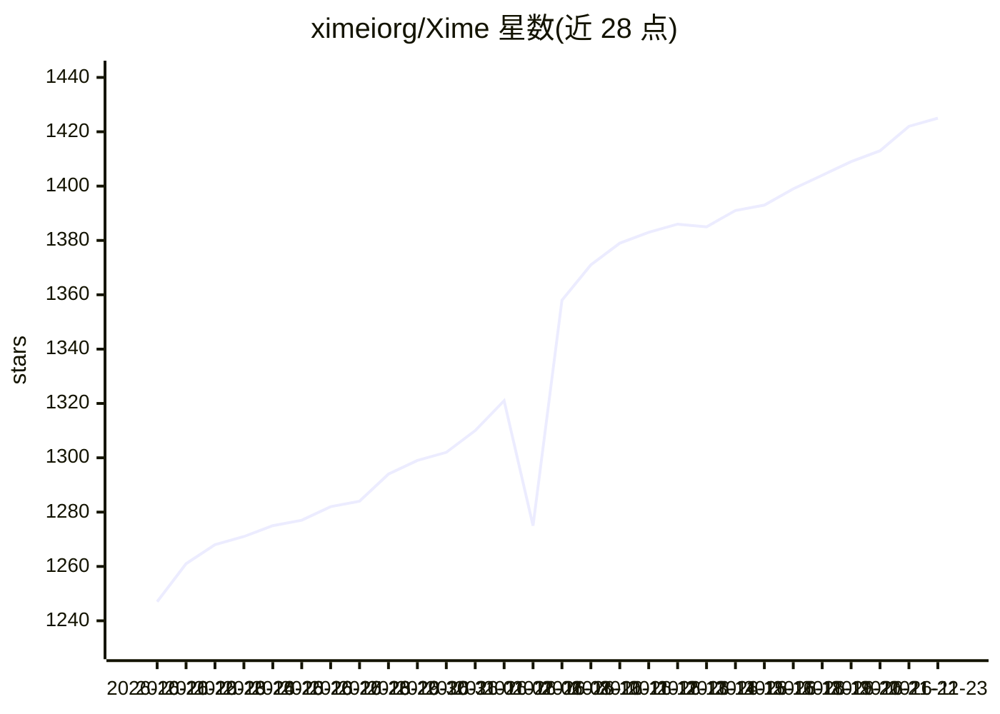

# ximeiorg/Xime

⭐ 1,425 · Kotlin · GPL-3.0 · 推送 2026-11-22 · [GitHub](https://github.com/ximeiorg/Xime) · [官网](https://ime.ximei.me) · 个人维护 · 中文 README

**基于 Rime 的安卓中文输入法，本地 AI 模型增强预测**

基于 Rime 引擎构建的安卓输入法，支持五笔 86/98、拼音及混合方案，可通过方案市场或无线导入自定义方案（双拼、笔画等）。键盘布局覆盖 QWERTY、T9 拼音、笔画九键、手写、数字键盘与悬浮键盘。本地 AI 部分包括基于 Transformer 的预测文本模型与内置 streaming zipformer2 的离线语音识别，另有 FunAsr、火山引擎等在线 ASR 插件。支持 Lua 插件市场、WebDAV 备份、剪贴板同步，要求 Android 9.0+，提供 APK 下载与源码构建。

## 筛选速览

| 维度 | 判定 | 备注 |
|---|---|---|
| AI 角色 | `ai-enhanced` | 去掉 AI 部分产品仍成立 |
| 许可风险 | `viral` | GPL-3.0 |
| 部署形态 | `None` |  |
| 模型依赖 | — | README 未给出锁定关系 |
| 硬件要求 | — | 无带数字的原话,不猜 |
| 安装摩擦 | `low` | 无编译、无系统依赖或容器化 |
| 成熟度 | — | 结构信号不足 |

## 能力要点

- 内置五笔 86/98、拼音、混合方案，支持自定义方案导入
- 基于 Transformer 的本地预测文本模型加速输入
- 离线语音识别（streaming zipformer2）与在线 ASR 插件
- Lua 插件市场可扩展表情、剪贴板同步等功能

## 适用场景

- 在安卓手机上使用五笔或拼音高效输入中文
- 离线环境下的语音转文字输入
- 通过方案市场安装双拼、笔画等自定义输入方案
- 多设备间同步剪贴板内容

## 场景标签

`语音识别` · 领域:感知与多模态

## 证据(README 行号)

> L22: An Android input method built on the Rime engine, designed for efficient Chinese text input with Wubi (五笔) and Piny
> L53: - **AI Enhancement** - Transformer-based predictive text for faster input

## 星数曲线

2026-10-21 1,247 → 2026-11-23 1,425（+178）

---
*卡片 v1 · prompt 1.4 · 生成 2026-11-23 · 置信度 high · 依据 README sha `5a54f883a97c` · [字段定义](../../DATASET.md)*
