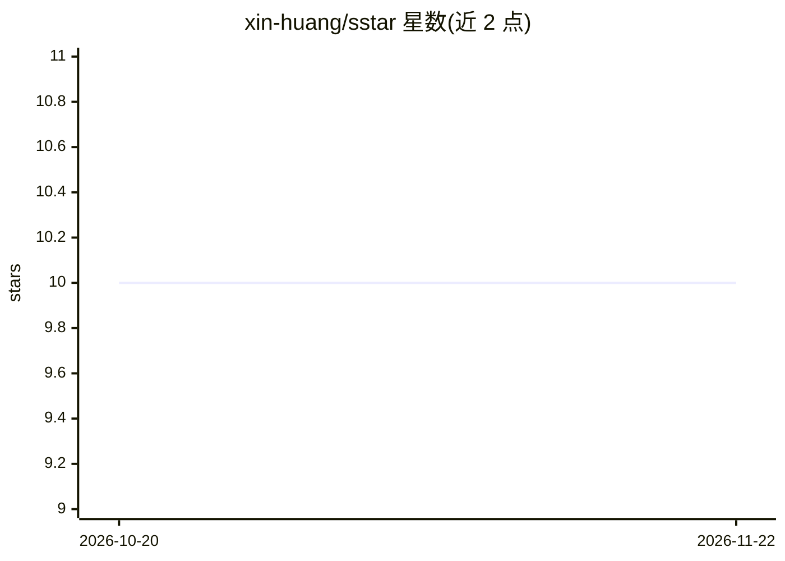

# xin-huang/sstar

⭐ 10 · Python · Apache-2.0 · 推送 2026-08-09 · [GitHub](https://github.com/xin-huang/sstar) · [官网](https://xin-huang.github.io/sstar) · 个人维护

**从群体遗传数据中检测古人类渐渗的 S* 方法实现**

sstar 是实现 S* 方法的工具，用于从群体遗传数据中检测古人类渐渗信号，包括幽灵渐渗与多来源渐渗场景，仓库主题标签涉及机器学习与群体基因组学。README 仅包含许可证、语言、构建状态、覆盖率、文档与下载等徽章链接，功能细节需查阅其在线手册获取，安装与使用方式以手册为准。

## 筛选速览

| 维度 | 判定 | 备注 |
|---|---|---|
| AI 角色 | `ai-native` | 本体是模型或模型工具 |
| 许可风险 | `permissive` | Apache-2.0 |
| 部署形态 | `None` |  |
| 模型依赖 | — | README 未给出锁定关系 |
| 硬件要求 | — | 无带数字的原话,不猜 |
| 安装摩擦 | `low` | 无编译、无系统依赖或容器化 |
| 成熟度 | — | 结构信号不足 |

## 能力要点

- 实现 S* 渐渗检测方法
- 支持幽灵渐渗（ghost introgression）检测
- 支持多来源渐渗（multisource introgression）检测
- 提供在线手册文档

## 适用场景

- 检测群体基因组数据中的古人类渐渗片段
- 研究无参考基因组的幽灵渐渗群体
- 分析多个渐渗来源的混合信号

## 场景标签

`科研工具` · 领域:学习与行业

## 证据(README 行号)

> L1: # sstar
> L10: The manual can be found here.

## 星数曲线

2026-10-20 10 → 2026-11-22 10（+0）

---
*卡片 v1 · prompt 1.4 · 生成 2026-11-19 · 置信度 low · 依据 README sha `14952a8773aa` · [字段定义](../../DATASET.md)*
