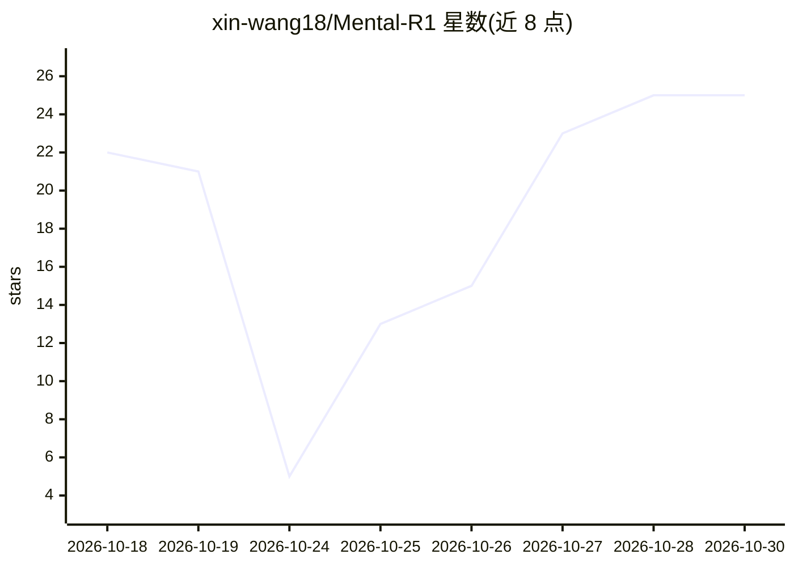

# xin-wang18/Mental-R1

⭐ 25 · Python · Apache-2.0 · 推送 2026-10-08 · [GitHub](https://github.com/xin-wang18/Mental-R1) · 组织维护 · 中文 README

**用强化学习对齐 LLM 推理以做心理健康评估的训练框架（CRPO）**

牛津大学与上海交通大学团队的论文官方实现：提供 Cognitive Relative Policy Optimization (CRPO) 强化学习训练代码，将 Qwen3-8B 等模型的推理过程对齐到心理健康评估任务，如焦虑/抑郁风险、自杀相关内容严重度、心理压力与孤独感检测。训练环境为 Linux + 支持 bf16 的 NVIDIA GPU（论文实验用 8 张 RTX PRO 6000）+ DeepSpeed，基于 TRL 0.21.0 覆写内部 trainer 方法。代码以 Apache 2.0 许可，trainer 部分改编自 Hugging Face TRL。

## 筛选速览

| 维度 | 判定 | 备注 |
|---|---|---|
| AI 角色 | `ai-ecosystem` | LLM/agent 周边工具 |
| 许可风险 | `permissive` | Apache-2.0 |
| 部署形态 | `library` | 以包/库形式分发 |
| 模型依赖 | — | README 未给出锁定关系 |
| 硬件要求 | — | 无带数字的原话,不猜 |
| 安装摩擦 | `medium` | 含编译或系统依赖之一 |
| 成熟度 | — | 结构信号不足 |

## 能力要点

- CRPO 强化学习训练框架的官方实现
- 基于 Qwen3-8B 与 TRL 0.21.0，DeepSpeed ZeRO-2 分布式训练
- 覆盖 8 个心理健康评估基准数据集（抑郁/焦虑/自杀风险/压力/孤独感）

## 适用场景

- 复现论文中的 Mental-R1 训练流程
- 在自有心理健康评估数据集上做 LLM 推理对齐训练
- 研究强化学习方法在临床文本评估任务上的应用

## 场景标签

`强化学习` `微调` · 领域:训练与推理

## 证据(README 行号)

> L16: This repository contains the official implementation of **Cognitive Relative Policy Optimization (CRPO)**, the rein
> L78: |Dataset|Assessment task|

## 星数曲线

2026-10-18 22 → 2026-10-30 25（+3）

---
*卡片 v1 · prompt 1.4 · 生成 2026-10-27 · 置信度 high · 依据 README sha `39244a751ac7` · [字段定义](../../DATASET.md)*
