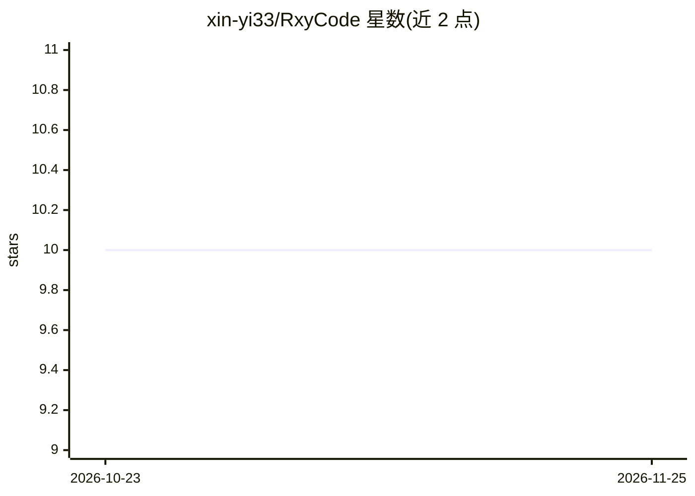

# xin-yi33/RxyCode

⭐ 10 · Python · MIT · 推送 2026-10-29 · [GitHub](https://github.com/xin-yi33/RxyCode) · [官网](https://github.com/xin-yi33/RxyCode/releases/latest) · 个人维护 · 中文 README

**本地优先的编码 Agent CLI，规划/执行/自检不只写代码**

以无头 Python 核心（Session over AgentV2）驱动的编码 Agent，CLI/OpenTUI 为主入口，另有 Ink 回退、Electron 桌面壳源码与 Web 控制台等客户端。机制包括：持久化 shell 会话但每次命令仍经风险分级与审批门、写文件时触发 compile/Ruff/node --check/tsc 诊断、可寻址的子 Agent（explore/reviewer 等）、confirm_all/auto_edit/full_auto 权限分级与硬拒绝清单、MCP 工具经同一审批与审计路径。模型流量走用户自配的 OpenAI 兼容端点（BYOK），Web 版无平台模型回退。v1.4.5 仅发布 sdist，无 wheel 与桌面安装包。

## 筛选速览

| 维度 | 判定 | 备注 |
|---|---|---|
| AI 角色 | `ai-native` | 本体是模型或模型工具 |
| 许可风险 | `permissive` | MIT |
| 部署形态 | `desktop` | 安装包/桌面程序 |
| 模型依赖 | — | README 未给出锁定关系 |
| 硬件要求 | — | 无带数字的原话,不猜 |
| 安装摩擦 | `low` | 无编译、无系统依赖或容器化 |
| 成熟度 | `idea` | |

## 能力要点

- 一次 Agent 循环修正作用于所有界面（CLI/TUI/API/Web 共用同一 Session 与 JSON-RPC 协议）
- 子 Agent 隔离会话与独立预算，父子归属来自运行时而非文本
- 写时诊断：Python compile/Ruff、JS node --check、TS 用项目自身 tsc 配置
- 权限分级含硬底线：shell 审批永不低于 WRITE，Plan 模式在执行层只读

## 适用场景

- 在本地终端让 Agent 规划、执行命令并验证结果
- 给文件写入设置审批门与风险分级，控制高风险操作
- 通过 MCP 按需加载工具并统一走审批审计路径
- 自带模型 Key 在 Web 控制台运行任务并产出工件预览

## 场景标签

`编码 Agent` · 领域:编码与开发

## 证据(README 行号)

> L5: **An MIT-licensed coding agent with a headless Python core. Run the CLI/OpenTUI on your machine, or use the same har
> L22: RxyCode is a coding agent you can run locally or from a browser. The core is a headless Python process (`Session` o
> L24: The CLI is the primary surface for v1.4.5. It plans, calls tools, runs commands, and verifies the result. Bring an 

## 星数曲线

2026-10-23 10 → 2026-11-25 10（+0）

---
*卡片 v1 · prompt 1.4 · 生成 2026-11-19 · 置信度 mid · 依据 README sha `dc2cb2845b89` · [字段定义](../../DATASET.md)*
