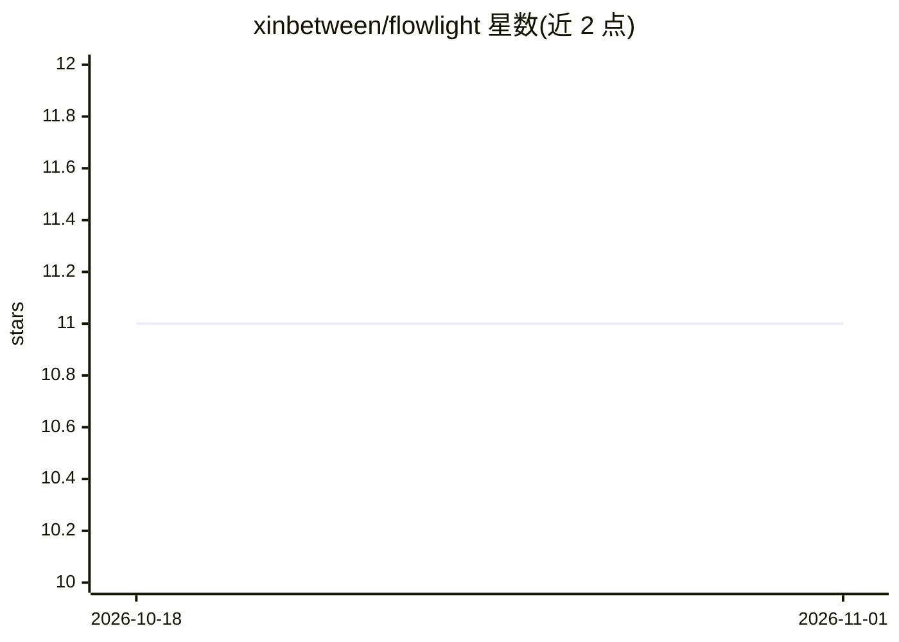

# xinbetween/flowlight

⭐ 11 · Swift · GPL-3.0 · 推送 2026-10-31 · [GitHub](https://github.com/xinbetween/flowlight) · [官网](http://flowlight.xinbetween.com/) · 个人维护

**macOS 原生网络监控器：按应用归属流量并审计 AI agent 的对外连接**

Swift 编写的 macOS 菜单栏网络监控应用（要求 macOS 15+，GPL-3.0，无遥测），将观测到的 TCP/UDP 流量归属到应用与目的地，识别 108 种协议。针对 AI agent：按名称识别 16 种 agent（Claude Code、Cursor 等），沿进程树将工具与 MCP 服务器产生的流量归到发起的 agent，支持按 agent 的域名/IP/CIDR 白名单与告警，可选本地 HTTPS 代理读取工具调用明细，并可通过 Network Extension 拒绝白名单外连接。另含规则系统、广告/追踪域名包与流量报表。

## 筛选速览

| 维度 | 判定 | 备注 |
|---|---|---|
| AI 角色 | `ai-enhanced` | 去掉 AI 部分产品仍成立 |
| 许可风险 | `viral` | GPL-3.0 |
| 部署形态 | `desktop` | 安装包/桌面程序 |
| 模型依赖 | — | README 未给出锁定关系 |
| 硬件要求 | — | 无带数字的原话,不猜 |
| 安装摩擦 | `low` | 无编译、无系统依赖或容器化 |
| 成熟度 | — | 结构信号不足 |

## 能力要点

- 按应用×目的地×协议归属流量，识别 108 种协议（13 族）
- 按名称识别 16 种 AI agent，工具与 MCP 服务器流量按进程树归因
- 按 agent 的白名单告警/阻断，6 条内置规则（如每小时上传超 100MB 疑似外泄）
- 可选 HTTPS 检查读取工具调用与 MCP 交互，凭据头不存储

## 适用场景

- 查看 Mac 上每个应用连接了哪些域名
- 监控编码 agent 及其工具/MCP 服务器是否连接模型提供方之外的地址
- 为 agent 设白名单并阻断越界连接，审计数据外泄风险

## 场景标签

`网络安全` · 领域:学习与行业

## 证据(README 行号)

> L5: **Application-aware network monitoring for macOS, with focused visibility into AI agents.**
> L7: A native macOS network monitor that attributes observed traffic to applications and destinations.
> L46: ### AI Agent Watch

## 星数曲线

2026-10-18 11 → 2026-11-01 11（+0）

---
*卡片 v1 · prompt 1.4 · 生成 2026-11-01 · 置信度 mid · 依据 README sha `50adc30c5108` · [字段定义](../../DATASET.md)*
