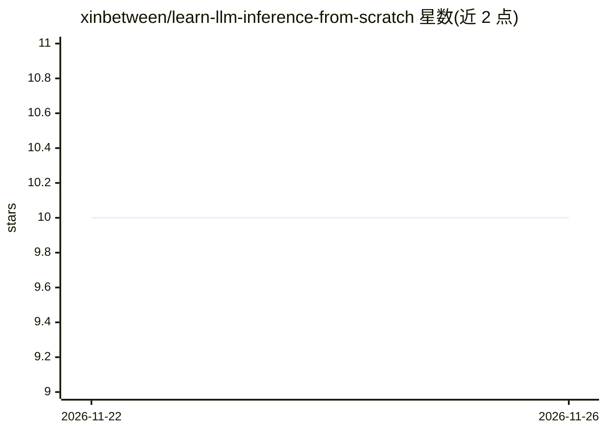

# xinbetween/learn-llm-inference-from-scratch

⭐ 10 · TypeScript · MIT · 推送 2026-09-27 · [GitHub](https://github.com/xinbetween/learn-llm-inference-from-scratch) · [官网](https://llminference.xinbetween.com/) · 个人维护 · 中文 README

**从零构建 LLM 推理引擎的动手教程（20 章 NumPy 实现）**

一门关于 LLM 推理原理的交互式课程仓库：从生成循环、BPE 分词、注意力机制讲起，逐层引入 KV cache、PagedAttention、continuous batching、投机解码、张量并行等机制，最终形成流式 OpenAI 兼容服务器。全部代码为 22 个自包含 NumPy 文件，无需 GPU、无需 PyTorch，可跑在笔记本上，并在 CI 中断言章节论点。面向在推理引擎之上开发、准备推理/系统岗位面试或阅读 vLLM 源码受挫的工程师。含 138 道测验题、22 个可破坏的模拟器，英文与中文双语。

## 筛选速览

| 维度 | 判定 | 备注 |
|---|---|---|
| AI 角色 | `ai-knowledge` | 知识聚合/清单类 |
| 许可风险 | `permissive` | MIT |
| 部署形态 | `library` | 以包/库形式分发 |
| 模型依赖 | — | README 未给出锁定关系 |
| 硬件要求 | — | 无带数字的原话,不猜 |
| 安装摩擦 | `medium` | 含编译或系统依赖之一 |
| 成熟度 | — | 结构信号不足 |

## 能力要点

- 22 个自包含 NumPy 文件，CI 中全部可运行并断言章节论点
- 覆盖 KV cache/PagedAttention/continuous batching/投机解码/张量并行
- 138 道分级测验题与 22 个可交互模拟器
- 英文与中文完整双语（含图表标签与工具提示）

## 适用场景

- 在推理引擎之上开发，想弄清各调优参数的作用机制
- 准备推理/系统方向面试，理解 decode 内存瓶颈与 PagedAttention
- 读 vLLM 源码前先通过课程理解各设计动机

## 场景标签

`教程课程` · 领域:学习与行业

## 证据(README 行号)

> L1: # Build an LLM Inference Engine From Scratch
> L38: **No GPU. No downloads. No PyTorch.** 6,700 lines of NumPy that run on a laptop in
> L41: ## Who this is for

## 星数曲线

2026-11-22 10 → 2026-11-26 10（+0）

---
*卡片 v1 · prompt 1.4 · 生成 2026-11-22 · 置信度 mid · 依据 README sha `b7cde92b84f5` · [字段定义](../../DATASET.md)*
