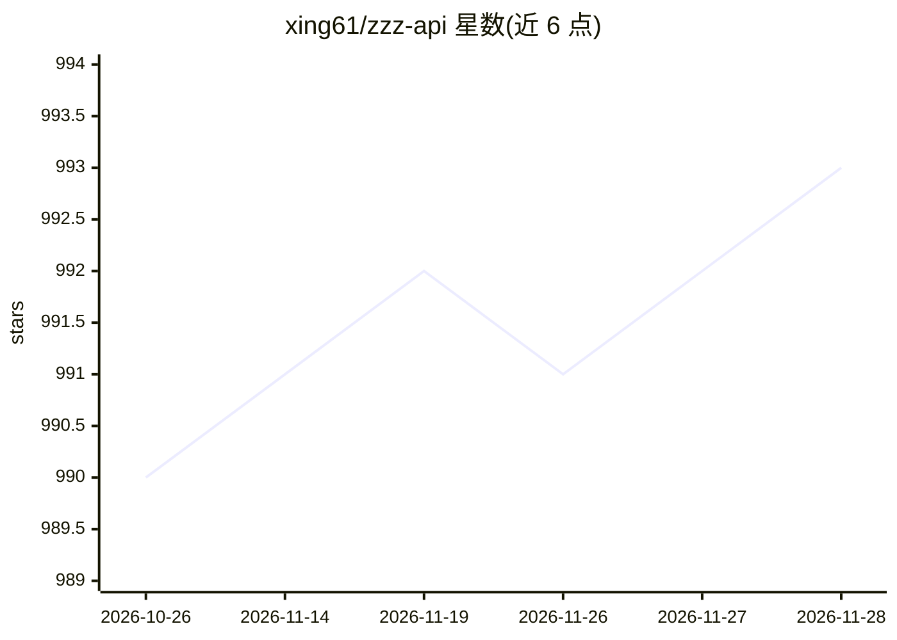

# xing61/zzz-api

⭐ 993 · 推送 2026-11-17 · [GitHub](https://github.com/xing61/zzz-api) · [官网](https://platform.zhizengzeng.com/#/login?aff=github) · 组织维护 · 中文 README

**面向企业和开发者的大模型 API 接口服务（代理网关）**

智增增（zzz-api.top）为企业与开发者提供多种大模型 API 的接口代理：兼容 OpenAI 接口格式，替换 base_url 与 API key 即可调用，覆盖 chat、batch、assistant、Fine-tuning、Embedding、TTS、Whisper 语音识别、DALL-E-3 文生图、函数调用与 stream 模式；同时提供 Anthropic claude、Google gemini、xAI grok 的官方接口形式，以及百度文心一言、阿里、讯飞星火、ChatGLM、DeepSeek 等模型。充值走微信与对公付款，管理后台提供 Secret Key、调用记录与余额查询。

## 筛选速览

| 维度 | 判定 | 备注 |
|---|---|---|
| AI 角色 | `ai-ecosystem` | LLM/agent 周边工具 |
| 许可风险 | `none` | — |
| 部署形态 | `None` |  |
| 模型依赖 | locked-api |  |
| 硬件要求 | — | 无带数字的原话,不猜 |
| 安装摩擦 | `low` | 无编译、无系统依赖或容器化 |
| 成熟度 | — | 结构信号不足 |

## 能力要点

- 兼容 OpenAI 接口格式，替换 base_url 即可平替调用
- 支持 Claude、Gemini、xAI grok 官方接口形式
- 覆盖 batch、assistant、fine-tune、Embedding、Whisper、TTS、DALL-E-3 等接口
- 管理后台提供独立 Secret Key、调用记录与余额查询

## 适用场景

- 国内开发者无美元银行卡时调用 OpenAI/Claude/Gemini 等模型
- Langchain、向量库、AutoGPT 等应用通过 Embedding 接口接入
- 用自有数据对 GPT 模型做 fine-tune 微调
- 企业通过对公付款采购大模型 API 服务

## 场景标签

`微调` `模型网关` · 领域:Agent 开发

## 证据(README 行号)

> L4: 智增增API(zzz-api.top) - 为企业和开发者提供优质稳定的各类大模型的API接口。
> L20:  * 兼容OpenAI接口格式，可以做到平替。

## 星数曲线

2026-10-26 990 → 2026-11-28 993（+3）

---
*卡片 v1 · prompt 1.4 · 生成 2026-11-24 · 置信度 high · 依据 README sha `81c7466c5082` · [字段定义](../../DATASET.md)*
