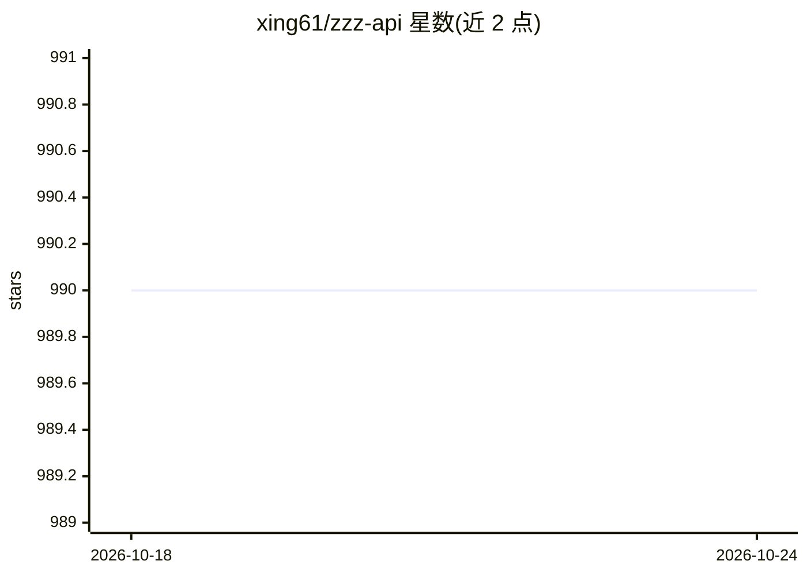

# xing61/zzz-api

⭐ 990 · 推送 2026-09-13 · [GitHub](https://github.com/xing61/zzz-api) · [官网](https://platform.zhizengzeng.com/#/login?aff=github) · 组织维护 · 中文 README

**智增增：多模型 LLM API 中转代理服务（OpenAI 兼容）**

智增增提供的商业 API 接口服务：以兼容 OpenAI 接口格式的代理形式，向企业与开发者提供 GPT、Claude、Gemini、文心一言、讯飞星火、ChatGLM、DeepSeek 等多家模型访问，无需自购官方账号或美元银行卡，支持微信充值与对公付款。能力覆盖 batch、assistant、fine-tune、Embedding、DALL-E-3、Whisper 语音识别、TTS、function call 与流式输出。使用时将 base_url 指向其域名并以管理后台获取的 API Key 认证；仓库本身不含代码，仅文档与示例。

## 筛选速览

| 维度 | 判定 | 备注 |
|---|---|---|
| AI 角色 | `ai-ecosystem` | LLM/agent 周边工具 |
| 许可风险 | `none` | — |
| 部署形态 | `None` |  |
| 模型依赖 | locked-api |  |
| 硬件要求 | — | 无带数字的原话,不猜 |
| 安装摩擦 | `low` | 无编译、无系统依赖或容器化 |
| 成熟度 | — | 结构信号不足 |

## 能力要点

- 兼容 OpenAI 接口格式，替换 base_url 即可调用
- 支持 batch / assistant / fine-tune / Embedding / Whisper / TTS / DALL-E-3
- 同时支持 Claude、Gemini、xAI grok 官方接口形式
- 提供 LangChain 与原生 HTTP 请求的接入示例

## 适用场景

- 国内支付方式调用 OpenAI 等海外模型 API
- 让依赖 OpenAI SDK 的现有应用切换到中转服务
- 通过统一接口访问多家大模型

## 场景标签

`模型网关` · 领域:Agent 开发

## 证据(README 行号)

> L5: 支持OpenAI, Anthropic、Gemini等多种接口格式访问大模型
> L20:  * 兼容OpenAI接口格式，可以做到平替。
> L50: 2、设置base_url为：`https://api.zhizengzeng.com/v1/`, 替换官方的域名: `https://api.openai.com/v1/`

## 星数曲线

2026-10-18 990 → 2026-10-24 990（+0）

---
*卡片 v1 · prompt 1.4 · 生成 2026-10-21 · 置信度 high · 依据 README sha `d149afe7e288` · [字段定义](../../DATASET.md)*
