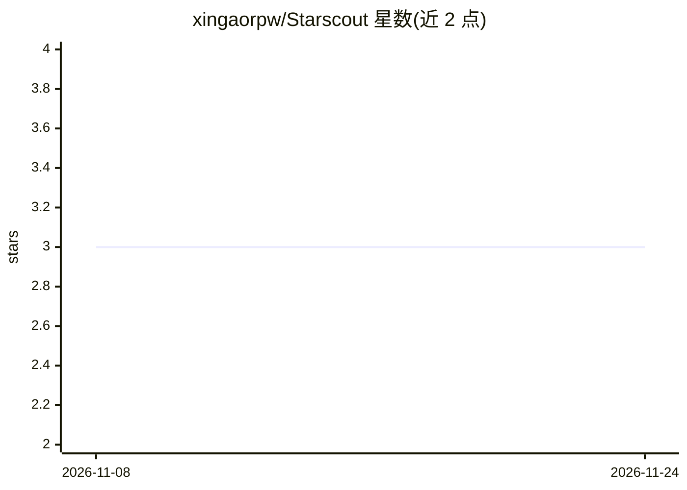

# xingaorpw/Starscout

⭐ 3 · Python · MIT · 推送 2026-11-06 · [GitHub](https://github.com/xingaorpw/Starscout) · 个人维护 · 中文 README

**给开发者的每日 GitHub 个性化推荐榜单工具**

基于 Flask + SQLite 的单机应用：通过 GitHub Search API 与 Trending 页采集新项目，用哈希 TF-IDF 向量化仓库描述与 topics，以 SGD 逻辑回归学习用户 👍/👎 反馈形成口味画像，再按口味、质量、新鲜度三路加权打分并做 MMR 多样性重排。推荐理由从模型权重反查生成，可解释。约 1800 行代码，无 GPU、无大模型调用，README 附 48 个单元测试与外部审计问题修复记录。

## 筛选速览

| 维度 | 判定 | 备注 |
|---|---|---|
| AI 角色 | `ai-enhanced` | 去掉 AI 部分产品仍成立 |
| 许可风险 | `permissive` | MIT |
| 部署形态 | `library` | 以包/库形式分发 |
| 模型依赖 | — | README 未给出锁定关系 |
| 硬件要求 | `cpu-ok` | |
| 安装摩擦 | `low` | 无编译、无系统依赖或容器化 |
| 成熟度 | — | 结构信号不足 |

## 能力要点

- 👍/👎 反馈驱动口味画像，带冷启动先验与 45 天半衰期时间衰减
- 三路打分（口味 z 分/质量分/新鲜度）+ MMR 与同语言上限保证多样性
- 推荐理由从模型权重反查生成，仅允许用户点过赞的 topic 出现
- 48 个测试用例，记录外部审计 7 个问题的修复过程

## 适用场景

- 每天刷一份按自己口味排序的 GitHub 新项目榜单
- 通过点赞收藏让推荐逐步贴合个人兴趣方向
- 离线灌入演示数据，无网络也能查看推荐效果

## 场景标签

`推荐系统` · 领域:学习与行业

## 证据(README 行号)

> L6: 每天从 GitHub 捞一批正在冒头的项目，按**你的口味**排序推给你；
> L92: 不是让大模型猜，是一个能解释的小模型。四步：
> L113: final = 0.58 × tanh(口味 z 分) + 0.27 × 质量分 + 0.15 × 新鲜度

## 星数曲线

2026-11-08 3 → 2026-11-24 3（+0）

---
*卡片 v1 · prompt 1.4 · 生成 2026-11-21 · 置信度 mid · 依据 README sha `91e416a1cf6d` · [字段定义](../../DATASET.md)*
