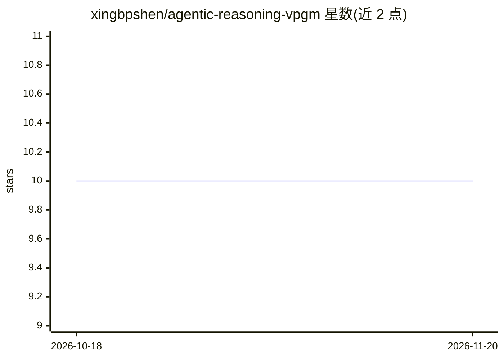

# xingbpshen/agentic-reasoning-vpgm

⭐ 10 · Python · MIT · 推送 2025-12-11 · [GitHub](https://github.com/xingbpshen/agentic-reasoning-vpgm) · 组织维护

**研究者复现 BayesAgent 论文的官方实验代码库**

AAAI 2026 论文 BayesAgent 的官方实现：提出 vPGM（Verbalized Probabilistic Graphical Modeling）贝叶斯 agentic 框架，通过自然语言引导 LLM agent 遵循概率图模型原则，并用数值贝叶斯推断修正后验分布，用于不确定性下的推理任务。仓库提供 venv/pip 环境、ScienceQA 处理子集下载与推理脚本 auto_run.sh，面向复现论文实验的研究者。数据集采用 CC BY-NC-SA 4.0 许可。

## 筛选速览

| 维度 | 判定 | 备注 |
|---|---|---|
| AI 角色 | `ai-native` | 本体是模型或模型工具 |
| 许可风险 | `permissive` | MIT |
| 部署形态 | `library` | 以包/库形式分发 |
| 模型依赖 | — | README 未给出锁定关系 |
| 硬件要求 | — | 无带数字的原话,不猜 |
| 安装摩擦 | `low` | 无编译、无系统依赖或容器化 |
| 成熟度 | — | 结构信号不足 |

## 能力要点

- vPGM：以自然语言引导 LLM agent 应用概率图模型原则
- 数值贝叶斯推断修正后验分布
- 提供处理后的 ScienceQA 数据子集（含全部工具响应）
- 通过 bash auto_run.sh 一键运行推理并输出结果文件

## 适用场景

- 复现 BayesAgent 论文的实验结果
- 研究 LLM agent 与概率图模型结合的不确定性推理
- 在 ScienceQA 等基准上测试贝叶斯 agentic 推理方法

## 场景标签

`模型评测` `科研工具` `Agent 框架` · 领域:Agent 开发

## 证据(README 行号)

> L8: This repository contains the official implementation of the paper:
> L18: In this work, we explore for the first time how to bridge LLM agents with probabilistic graphical models (PGMs) to 
> L58: Please run the following command to run inference:

## 星数曲线

2026-10-18 10 → 2026-11-20 10（+0）

---
*卡片 v1 · prompt 1.4 · 生成 2026-11-19 · 置信度 high · 依据 README sha `488f06ef2ad5` · [字段定义](../../DATASET.md)*
