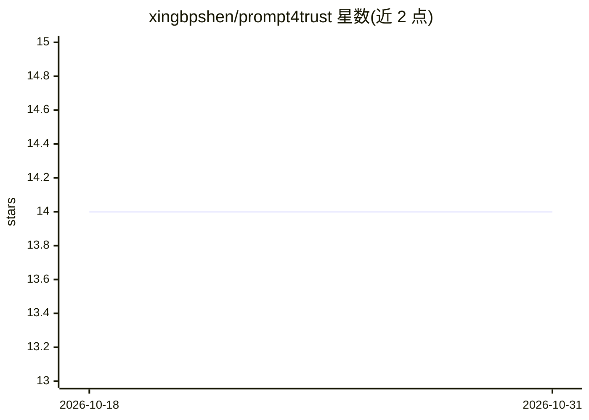

# xingbpshen/prompt4trust

⭐ 14 · Python · MIT · 推送 2025-12-11 · [GitHub](https://github.com/xingbpshen/prompt4trust) · 组织维护

**论文官方实现：RL 提示增强校准 MLLM 临床置信度**

ICCV 2025 Workshop 论文 Prompt4Trust 的官方 PyTorch 实现：训练一个轻量级 LLM 策略模型（基于 TRL 的 GRPO），生成上下文感知的辅助提示，引导下游 MLLM 输出更贴近真实准确率的置信度分数，面向医疗影像问答等安全关键场景。训练需启动 2 个 vLLM 服务分别采样动作与计算奖励，要求至少 4 块 NVIDIA GPU 且三组 CUDA 设备不得重叠。提供 PMC-VQA 数据集的训练/评测流程，并可在 Hugging Face 下载已训练的 CGP Generator 跳过训练。

## 筛选速览

| 维度 | 判定 | 备注 |
|---|---|---|
| AI 角色 | `ai-native` | 本体是模型或模型工具 |
| 许可风险 | `permissive` | MIT |
| 部署形态 | `library` | 以包/库形式分发 |
| 模型依赖 | local-ok | 支持本地模型 |
| 硬件要求 | — | 无带数字的原话,不猜 |
| 安装摩擦 | `medium` | 含编译或系统依赖之一 |
| 成熟度 | — | 结构信号不足 |

## 能力要点

- 轻量 LLM 策略模型经 GRPO（TRL）训练生成辅助提示
- 下游 MLLM 输出临床对齐的置信度校准分数
- vLLM serving 支撑动作采样与奖励计算（双服务）
- 提供已训练 CGP Generator 下载以跳过训练步骤

## 适用场景

- 复现论文在 PMC-VQA 上的置信度校准实验
- 为医疗 MLLM 问答系统做提示增强与可信度校准
- 研究零样本泛化到更大 MLLM 的校准效果

## 场景标签

`提示工程` `强化学习` · 领域:Agent 开发

## 证据(README 行号)

> L17: Multimodal large language models (MLLMs) show great potential for healthcare applications, but their clinical deplo
> L10: > __Prompt4Trust: A Reinforcement Learning Prompt Augmentation Framework for Clinically-Aligned Confidence Calibrat

## 星数曲线

2026-10-18 14 → 2026-10-31 14（+0）

---
*卡片 v1 · prompt 1.4 · 生成 2026-10-31 · 置信度 mid · 依据 README sha `19e335466eef` · [字段定义](../../DATASET.md)*
