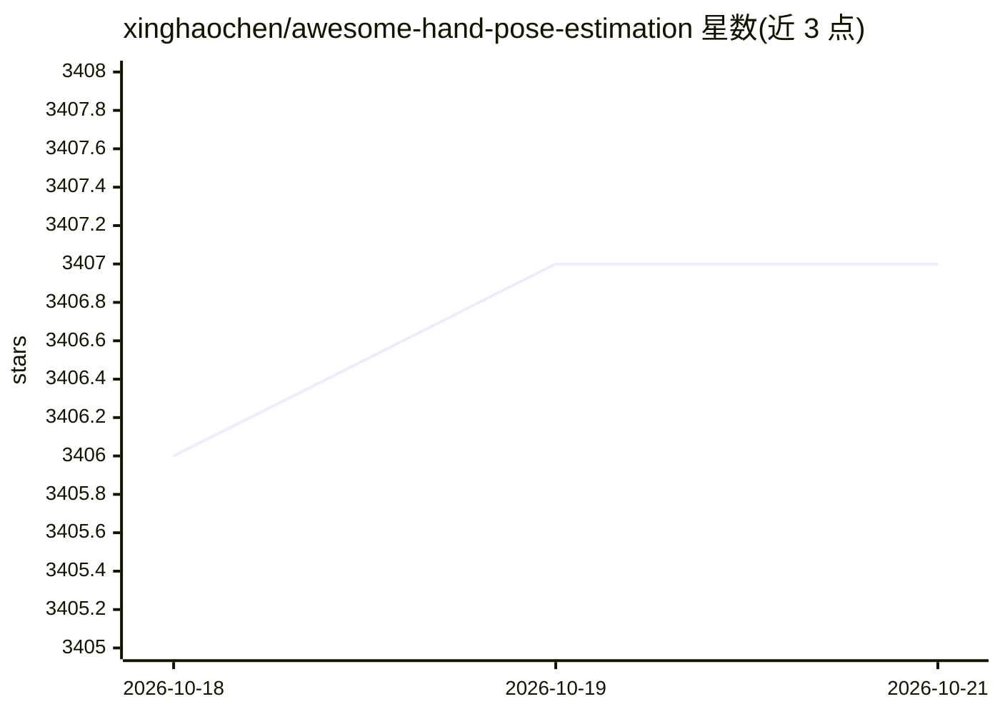

# xinghaochen/awesome-hand-pose-estimation

⭐ 3,407 · Python · 推送 2026-06-28 · [GitHub](https://github.com/xinghaochen/awesome-hand-pose-estimation) · [官网](https://xinghaochen.github.io/awesome-hand-pose-estimation/) · 个人维护

**手势姿态估计/跟踪研究论文与资源的策展清单**

手势姿态估计（hand pose estimation）领域的策展资源清单：按 arXiv 论文、TPAMI/IJCV 期刊论文等分类收录条目，覆盖基于深度图、RGB 单目、多视角、事件相机等输入的 2D/3D 手部关键点、手部网格重建与手物交互方法。条目附论文 PDF、项目主页、代码与数据集链接，部分条目提供代码仓库。仓库另含 evaluation 文件夹，用于手势姿态估计的性能评估，面向计算机视觉研究选型与文献调研。

## 筛选速览

| 维度 | 判定 | 备注 |
|---|---|---|
| AI 角色 | `ai-knowledge` | 知识聚合/清单类 |
| 许可风险 | `none` | — |
| 部署形态 | `None` |  |
| 模型依赖 | — | README 未给出锁定关系 |
| 硬件要求 | — | 无带数字的原话,不猜 |
| 安装摩擦 | `low` | 无编译、无系统依赖或容器化 |
| 成熟度 | — | 结构信号不足 |

## 能力要点

- 按 arXiv 与 TPAMI/IJCV 期刊论文分类组织
- 条目附 PDF、项目主页、代码与数据集链接
- 含 evaluation 文件夹提供性能评估细节
- 覆盖深度图、RGB、多视角、事件相机等多种输入模态

## 适用场景

- 查找手势姿态估计方向的论文与开源实现
- 对比不同输入模态下的手部姿态估计方法
- 调研手物交互与手部重建相关数据集

## 场景标签

`精选清单` `科研工具` · 领域:学习与行业

## 证据(README 行号)

> L3: A curated list of related resources for hand pose estimation. Feel free to contribute!
> L9: See folder ``evaluation`` to get more details about performance evaluation for hand pose estimation.

## 星数曲线

2026-10-18 3,406 → 2026-10-21 3,407（+1）

---
*卡片 v1 · prompt 1.4 · 生成 2026-10-20 · 置信度 high · 依据 README sha `c88f9eeb45b3` · [字段定义](../../DATASET.md)*
