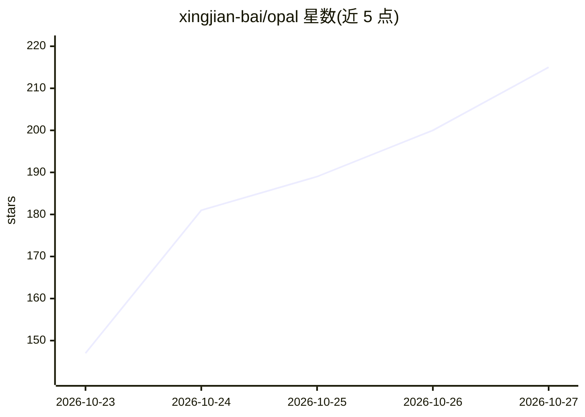

# xingjian-bai/opal

⭐ 215 · Python · MIT · 推送 2026-10-25 · [GitHub](https://github.com/xingjian-bai/opal) · [官网](https://xingjianbai.com/reactive-optimizers/) · 个人维护

**PyTorch 优化器包装器：让编程 agent 在训练中改写优化器**

OPAL 是一个 PyTorch 优化器包装库：把用户已有的优化器包装后，由编码 agent（默认 Claude Code）在训练过程中定期读取运行报告，并改写两个程序——负责梯度更新的 updater 和负责测量的 analysis。改写范围限于优化器代码（更新规则、学习率、动量、裁剪等），不改模型/数据/损失；新程序先试运行 20 步，出错可回退。支持 CPU/单机单卡或 DDP，提供 keep 后端做零成本对照、成本上限与 HTML 报告；多节点、FSDP、DeepSpeed 不支持。v0.3.6 开发中。

## 筛选速览

| 维度 | 判定 | 备注 |
|---|---|---|
| AI 角色 | `ai-ecosystem` | LLM/agent 周边工具 |
| 许可风险 | `permissive` | MIT |
| 部署形态 | `library` | 以包/库形式分发 |
| 模型依赖 | locked-api |  |
| 硬件要求 | `cpu-ok` | |
| 安装摩擦 | `medium` | 含编译或系统依赖之一 |
| 成熟度 | `idea` | |

## 能力要点

- 一行代码包装现有优化器，agent 在决策点改写 updater/analysis 两个程序
- keep 后端可逐字节复现原始运行，用于零成本校验
- 新程序 20 步试运行与快照回退机制（snapshot_limit_gb 默认 2GB）
- 支持 CPU/单卡/DDP、HF Trainer（OpalTrainer）与 Codex 实验后端

## 适用场景

- 在长训练任务中让 agent 按运行反馈调学习率与更新规则
- 图像生成、语言模型等任务的优化器自动调优并留存每步决策报告
- 无外网的 GPU 机器上通过 mailbox/ssh 由本机 agent 远程驱动训练

## 场景标签

`编码 Agent` `模型训练` · 领域:编码与开发

## 证据(README 行号)

> L3:  A PyTorch optimizer wrapper that lets a coding agent change the optimizer while your model trains.
> L12: optimizer in one line. Every so often the agent (Claude Code) reads what the run reports and decides whether to
> L162: v0.3.6, under active development. Tested on one GPU and on DDP within one node (NCCL, eager and `torch.compile`).

## 星数曲线

2026-10-23 147 → 2026-10-27 215（+68）

---
*卡片 v1 · prompt 1.4 · 生成 2026-10-23 · 置信度 high · 依据 README sha `892ec3bb09e5` · [字段定义](../../DATASET.md)*
